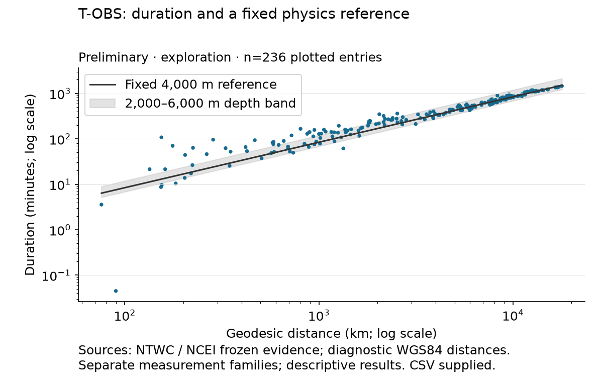
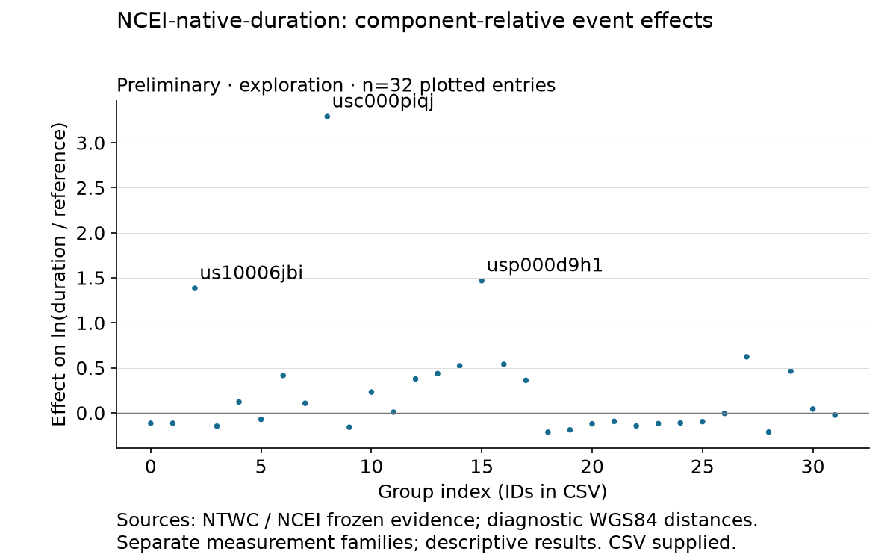
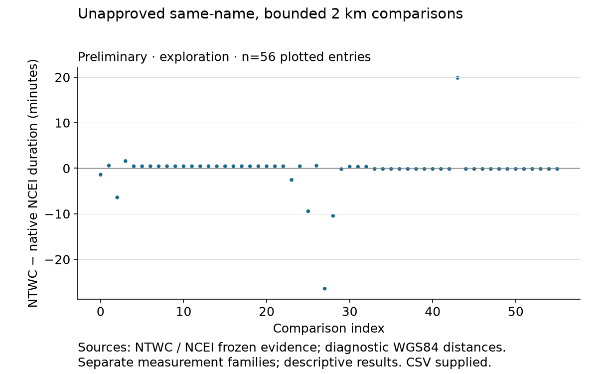
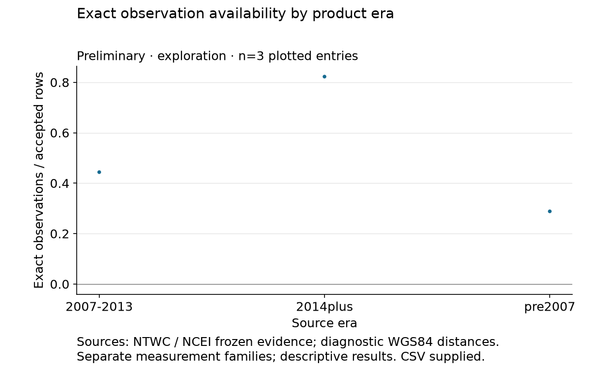
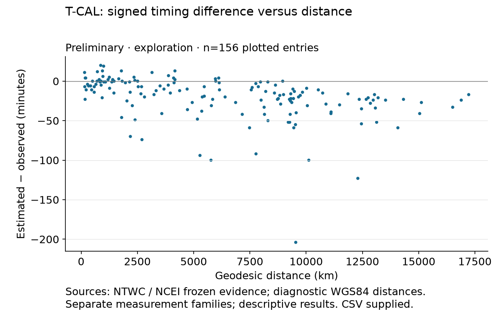

# Preliminary arrival-timing EDA

This analysis describes what the accepted arrival evidence can support before Bayesian modeling. It preserves separate NTWC reported durations, NCEI native travel durations, and signed estimated-minus-observed timing differences. No records were repaired or removed, and no likelihood, prior or model was fitted or selected.

The NCEI near-field departure from a fixed depth reference repeats in confirmation, as does stronger dispersion across distance groups. Exact-UTC availability remains uneven across source eras. Station-effect stability, cross-source identity/ancestry and the missingness mechanism remain unresolved. The signed forecast comparison has median −15.5 min in exploration and −13 min in confirmation; its distance-trend evidence is too sparse to confirm.

## Read the targets separately

**T-OBS** is reported observed UTC minus a reviewed USGS reference origin. **NCEI-native-duration** preserves the source's explicit positive travel duration without reconstructing missing arrival dates. **T-CAL** is estimated UTC minus observed UTC, in minutes: a negative value means the published estimate precedes the reported observation. None is public alert lead time or an independently validated physical onset.

| Target | Split | Records | Events | Sites | Median (min) | MAD (min) |
| --- | --- | ---: | ---: | ---: | ---: | ---: |
| T-OBS | exploration | 236 | 14 | 160 | 440 | 316.1 |
| NCEI-native-duration | exploration | 1070 | 33 | 439 | 429 | 299 |
| T-CAL | exploration | 156 | 13 | 95 | -15.5 | 13.5 |
| T-OBS | confirmation | 22 | 6 | 20 | 219.4 | 98.35 |
| NCEI-native-duration | confirmation | 151 | 14 | 97 | 258 | 191 |
| T-CAL | confirmation | 13 | 5 | 12 | -13 | 12 |

MAD is the unscaled median absolute deviation. See [all target summaries](results/response-distributions-and-event-station-support.csv) and the [exploration-only observable scales](results/exploration-response-quantiles-and-robust-spread.csv) for q10/q50/q90 values.

## Design and uncertainty

The metadata-only, region-by-era split assigns 38 development archive entries to exploration and 19 to confirmation, with seed 20261103. Tōhoku 2011 and Chile 2010 are forced to exploration. Sparse strata may occur in one half only. The 18 reserved event outcomes remain unopened. Prior metadata exposure is disclosed; no blindness is claimed.

One physical sequence crosses the archive-entry split: usp000d3ka (confirmation) and usp000d3mb (exploration). These halves therefore do not establish independent physical-sequence confirmation. Later evaluation needs event/sequence grouping. Small confirmation targets limit every replicated screen below.

Methods are descriptive: robust summaries, fixed distance bins, normal-reference QQ diagnostics, component-relative median polish, rank correlations and 500 event bootstrap resamples. The bootstrap resamples events, not independent rows. Its intervals are descriptive, not multiplicity-adjusted hypothesis tests. No p-values or posterior probabilities are reported.

## Distance and timing structure

The fixed diagnostic uses c = sqrt(g × 4000 m), t_ref = geodesic distance / c, and r₀ = ln(reported duration / t_ref). The band uses fixed depths 2000–6000 m. WGS84 geodesics are a stated approximation where original source datums are unknown. This straight-path, constant-depth reference is not a validated propagation forecast.

| Family | Exploration near−far median r₀ | Confirmation near−far median r₀ |
| --- | ---: | ---: |
| T-OBS | 0.4751 | 0.3858 |
| NCEI-native-duration | 0.602 | 0.6427 |



Near-field departures mix source extent, bathymetry/path, reporting and onset definitions. They motivate separate near-field and distance-scale candidates, not exclusions. Native NCEI distance numbers are retained for comparison, but their units were not verified in the frozen evidence, so no kilometre equivalence or physical ratio is asserted. No shoreline proxy was acquired.

The 0.045-minute NTWC duration at Lottin Point is 2.7 seconds: the displayed 16:38 clock minus reviewed 16:37:57.300 origin. The arithmetic matches the raw source. Minute display does not establish minute accuracy or a physical onset. It remains flagged and retained. All 150 exploration tail flags were traced to original source values; no proven transcription error was found. One NCEI/JMA first-wave definition comparison remains unapproved, and 148 other causes remain unresolved. QQ curvature does not select a heavy-tail likelihood.
All 26 confirmation NCEI tail flags also match their original native duration fields. Their specific causes remain unknown; they were retained.

## Groups, provenance and availability

NTWC's primary physical-site median polish has zero residual MAD; the NCEI primary component has site/residual MAD ratio 3.323 and event/residual ratio 4.225 in exploration. Only 250/500 physical-site and 261/500 bounded-2-km NCEI bootstrap ratios are finite. These conditional ratios are unstable; they do not identify variance components. Bootstrap resampling may disconnect the design. Components have separate origins, and changing the largest component under deletion limits effect comparisons.



In the frozen confirmation T-OBS event-effect figure, an optional right-edge ID annotation is clipped. The two plotted component-0 events are usp000hr97 (+0.0767355) and usp000jr83 (−0.0767355) on the log-ratio scale; their full IDs and values are preserved in the [figure CSV](results/confirmation/event-and-station-timing-variation/ntwc-reported-travel-duration-component-relative-event-log-timing-effects.csv). The frozen image and numerical output were preserved unchanged.

No direct cross-family shared geographic-ID comparison is available in either half. The posthoc P1 sensitivity uses existing same-name bounded-2-km keys and does not approve identities, deployments, common onsets, ancestry or independence. Its 56 exploration comparisons have median NTWC−NCEI difference −0.147 min (event-bootstrap interval −0.183 to +0.452): 48 below one minute in absolute difference, three from one to under five, and five at least five. Maximum coordinate separation is 1.248 km. Close agreement can reflect copying or definitions; it does not establish independent measurements.
Confirmation P1 contains zero co-location comparisons, so the 56-row exploration sensitivity cannot be confirmed in the second half.



The NCEI coastal−DART within-event duration contrast is an unmatched comparison: coastal and deep-ocean gauges occupy different distances and settings. Its 202.5-minute exploration contrast is not an estimated source bias. Site inventory providers are geographic metadata; actual arrival-pick provenance remains unknown. Original NTWC-report origin ancestry is also unresolved. Seventy-five separate documentary-product origin comparisons are not a substitute for that ancestry.

| Split | Retained reports | Accepted rows | Structural rows | Exact observed UTC | Source-absent observed value | Numeric peak among source-absent |
| --- | ---: | ---: | ---: | ---: | ---: | ---: |
| exploration | 1011 | 981 | 30 | 495 | 233 | 179 |
| confirmation | 166 | 161 | 5 | 83 | 56 | 11 |



Exact-UTC availability uses accepted source rows as its denominator; it is not an operating-station census or non-detection rate. Source-absent values are distinct from unresolved calendar/qualifier cases. Numeric peak presence differs from nonempty text or a dash. Peak-size comparisons stay within event/table/header scope with unknown native units. Era/format and event composition are confounded. MCAR, MAR and MNAR remain unidentified; the EDA does not extend the four documented individual missing-observation reasons.

LOEO tables retain every event deletion for pooled r₀ median/MAD, near−far contrast, component-effect MADs and selected C5 group contrasts. Very large relative changes can come from nearly zero contrast baselines. Consult the absolute changes and missing-contrast counts; they are not enormous physical shifts. This is not an exhaustive test of every possible C5 statistic.

## Signed forecast comparisons

T-CAL is a separate signed target. Exploration contains 156 comparisons from 13 events, with median −15.5 minutes, MAD 13.5, q10 −51 and q90 +3.5; 125/156 are negative. The median within-event distance-rank correlation is −0.453. Era is constant within an event, so it cannot identify a separate within-event era effect. Confirmation uses the same frozen question.



## Frozen branch results

Each selected question was rerun once with the frozen code/config and its exploratory route. A descriptive screen repeats when direction matches and magnitude lies within a factor of two, or its saved intervals overlap. Opposite signs are contradicted; insufficient support stays tentative. The table's confirmed labels concern the screen only, not causality, measurement validity, a likelihood, or independent-sequence generalization. B3 additionally requires the registered bootstrap stability. B11 was unidentifiable and did not trigger a confirmation branch; C5 was still rerun.

The T-OBS confirmation near-field group has one record, so B1/B9 remain tentative under the minimum-five-record screen. T-CAL has only two finite event-level confirmation trends, so B10 remains tentative. These support qualifications do not change any frozen question, scalar or threshold. B1/B9 reuse the same near−far contrast and are not independent confirmations.

| Branch | Target | Exploration scalar | Confirmation scalar | Disposition |
| --- | --- | ---: | ---: | --- |
| B1 | NCEI-native-duration | 0.602 | 0.6427 | confirmed descriptive screen |
| B1 | T-OBS | 0.4751 | 0.3858 | tentative: fewer than five confirmation records in a distance group |
| B2 | NCEI-native-duration | 0.115 | 0.1722 | confirmed descriptive screen |
| B2 | T-OBS | 0.1144 | 0 | tentative: magnitude did not replicate |
| B3 | NCEI-native-duration | 3.323 | 15.77 | tentative: bootstrap stability failed |
| B3 | T-OBS | unknown | unknown | unresolved: exploration untriggered or unidentifiable |
| B4 | NCEI-native-duration | 4.225 | 13.97 | tentative: magnitude did not replicate |
| B4 | T-OBS | unknown | unknown | unresolved: exploration untriggered or unidentifiable |
| B5 | NCEI-native-duration | 8.01 | 12.98 | confirmed descriptive screen |
| B5 | T-OBS | 22.78 | 1.997 | tentative: magnitude did not replicate |
| B6 | NCEI-native-duration | 202.5 | 128.2 | tentative: confirmation contrast interval/threshold inconclusive |
| B6 | T-OBS | unknown | unknown | unresolved: exploration untriggered or unidentifiable |
| B7 | NTWC-reports | 0.5344 | 0.4182 | confirmed descriptive screen |
| B8 | NCEI-native-duration | 34.85 | 1.339 | tentative: magnitude did not replicate |
| B8 | T-OBS | 11.42 | 13.34 | confirmed descriptive screen |
| B9 | NCEI-native-duration | 0.602 | 0.6427 | confirmed descriptive screen |
| B9 | T-OBS | 0.4751 | 0.3858 | tentative: fewer than five confirmation records in a distance group |
| B10 | T-CAL | -0.453 | -0.6357 | tentative: only two usable event-level confirmation trends |
| B11 | NCEI-native-duration | unknown | unknown | unresolved: exploration untriggered or unidentifiable |
| B11 | T-OBS | unknown | unknown | unresolved: exploration untriggered or unidentifiable |

See [routes and replication CSV](results/followup-pattern-replication.csv) and the original [frozen branch registry](frozen-inputs/registered-analysis-questions.md). Scalars have branch-specific units in the CSV and must not be compared across rows. B5/B7/B8 are nonnegative dispersion/availability/influence screens; repeating their magnitude does not establish the same ordered covariate effect or driver.

## Repeated-site and holdout support

| Target / split | Components | Structural rank | Sites in ≥2 / ≥3 / ≥5 events | Inverse-Simpson event concentration | Top-three event row share |
| --- | ---: | ---: | ---: | ---: | ---: |
| T-OBS / exploration | 3 | 171 | 47 / 19 / 3 | 4.315 | 0.7966 |
| NCEI-native-duration / exploration | 2 | 470 | 213 / 143 / 65 | 8.562 | 0.4953 |
| T-CAL / exploration | 3 | 105 | 36 / 16 / 2 | 4.475 | 0.7885 |
| T-OBS / confirmation | 4 | 22 | 2 / 0 / 0 | 4.745 | 0.7273 |
| NCEI-native-duration / confirmation | 2 | 109 | 34 / 13 / 1 | 8.601 | 0.4371 |
| T-CAL / confirmation | 4 | 13 | 1 / 0 / 0 | 3.314 | 0.8462 |

Structural additive rank is events + sites − connected components, not proof of stable variance estimation. Inverse-Simpson concentration describes event imbalance; it is not posterior effective sample size or a count of independent earthquakes. C9 retains every LOEO and LOSO support table, including whether held-out records use sites seen elsewhere.

## Decision memo for later modeling

These are candidate directions for T-PB-03; no model or prior is selected. Confirmation is small and not independent by physical sequence. A repeated screen can motivate a later comparison without validating the proposed model.

| Decision | T-OBS | NCEI native duration | T-CAL |
| --- | --- | --- | --- |
| Estimand | **Confirmed:** reported UTC minus reviewed origin; physical onset unresolved | **Confirmed:** native positive reported duration; date/onset unresolved | **Confirmed:** signed E−O, not alert lead time |
| Likelihood shape | **Tentative:** compare positive log-scale and robust observation-layer candidates; source-sensitive tails retained | **Tentative:** compare positive log-scale/robust candidates separately from NTWC | **Tentative:** compare signed symmetric/heavy-tail candidates; no positive-only likelihood |
| Group structure | **Unresolved:** zero residual MAD and sparse/disconnected cells prevent stable variance claims | **Tentative:** event/site candidates, with unstable bootstrap ratios disclosed | **Tentative:** event and repeated-site support must constrain complexity |
| Covariate form | **Tentative:** fixed-reference offset plus limited distance/near-field alternatives | **Tentative:** distance/near-field and coastal/DART sensitivity; no causal family offset | **Tentative:** within-event distance trend; era confounded with event |
| Observation layer | **Confirmed need:** retain clock/origin/definition uncertainty; accuracy unknown | **Confirmed need:** retain native duration/definition/precision provenance | **Confirmed need:** preserve forecast/observation definition and product-version uncertainty |
| Missingness | **Unresolved:** selection/availability sensitivity, not a learned causal mechanism | **Unresolved:** target eligibility is not a sensor-operating census | **Unresolved:** complete pairs select reports; no fabricated forecasts |
| Holdouts | **Tentative:** event/sequence grouping; inspect seen/unseen site support | **Tentative:** event/sequence and site holdouts from C9; no pooled source independence | **Tentative:** only 18 contributing events overall; nested event/sequence evaluation |
| Prior-predictive scales | **Tentative:** exploration q10/median/q90/MAD in saved CSV, not priors | **Tentative:** separate exploration native-duration scales, not priors | **Tentative:** signed exploration scales, not priors |
| Open questions | **Unresolved:** original report ancestry, source datum, physical onset | **Unresolved:** lineage, common target, native distance units | **Unresolved:** forecast issuance/version and actionable lead time |

## Artifacts and reproduction

The [figure and table index](figure-and-table-index.md) links every retained PNG/SVG/CSV set. Each question bundle includes meta/config/seeds/inputs/outputs/metrics/notes, a summary, a detailed Markdown report and checksums. The earlier checkpoint is preserved in preliminary-checkpoint/; results/ contains the consistent analysis.

Inputs: [148 pinned files](frozen-inputs/source-file-checksums.json), [development metadata](frozen-inputs/development-event-metadata.csv), [split and counts](frozen-inputs/response-record-event-station-counts.csv), [confirmation code/route lock](frozen-confirmation-definition.json). The underlying public-source snapshots are kept outside Git; obtain the accepted data release and verify its pins before replay. Source inventories and provenance are described in [the data guide](../../../docs/data/multi-event.md) and [source-process report](../../../docs/data/source-process.md).

Use the pinned environment and repository root. Question bundles refuse overwrites. For an existing confirmation question, use a new scratch output with `--replay`; it requires the lock and byte-identical canonical outputs:

```bash
MPLCONFIGDIR=/private/tmp/tsunami-paper-mpl .venv/bin/python scripts/run_arrival_timing_eda.py \
  --split confirmation --module C3 --replay \
  --output artifacts/generated/arrival-timing-replay/distance-reference-confirmation
.venv/bin/python -m scripts.build_arrival_timing_eda_report
```

Replaying is verification, not another adaptive look or an opportunity to change the question. Local MLflow records mirror the portable bundles. No primary timestamps, identities, pairs, reserved outcomes or fitted-model contracts were changed by this EDA.
