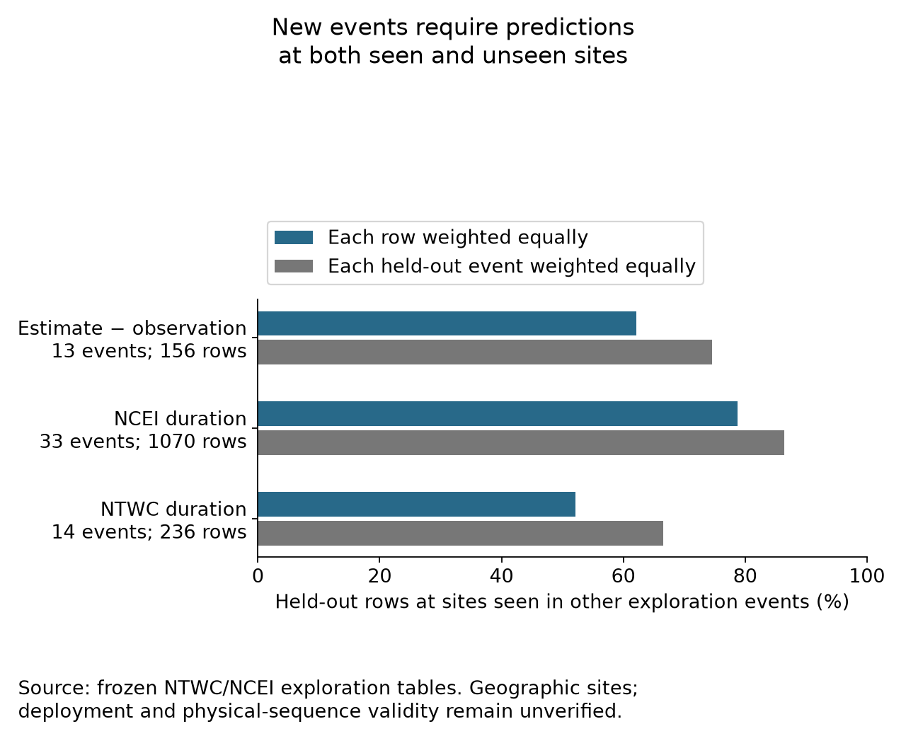

# Exploration design: what the model can learn

These posthoc checks describe the accepted exploration design. They do not
estimate Bayesian parameters or repeat the frozen confirmation analysis.

| Response | Rows | Events | Sites | Components | Unique edges | Cycle surplus |
| --- | ---: | ---: | ---: | ---: | ---: | ---: |
| NTWC duration | 236 | 14 | 160 | 3 | 236 | 65 |
| NCEI duration | 1070 | 33 | 439 | 2 | 1067 | 597 |
| Estimate − observation | 156 | 13 | 95 | 3 | 156 | 51 |

Cycle surplus = unique edges − events − sites + connected components.
It counts redundant contrasts for an unrestricted additive event/site design;
it is neither posterior effective sample size nor a variance-identification test.
Repeated rows on an edge do not establish independent replicate measurements.

| Response | Within-event fraction of log-distance variation | Seen-site fraction, row weighted | Seen-site fraction, event weighted |
| --- | ---: | ---: | ---: |
| NTWC duration | 79.6% | 52.1% | 66.6% |
| NCEI duration | 68.5% | 78.8% | 86.5% |
| Estimate − observation | 68.8% | 62.2% | 74.6% |

Log-distance variation decomposes exactly into within-event and row-weighted
between-event sums of squares. This measures predictor support,
not a response slope.
Event deletion here is a design check, not cross-validation
or a physical-sequence split.

[Model meanings, assumptions and next checks](../../../../docs/research/bayesian-model-readiness.md) explain inference limits and candidate progression.
Scenario CSVs contain deliberately assumed scales, not selected priors or known
clock accuracy. All rows stay in their original analysis views.
