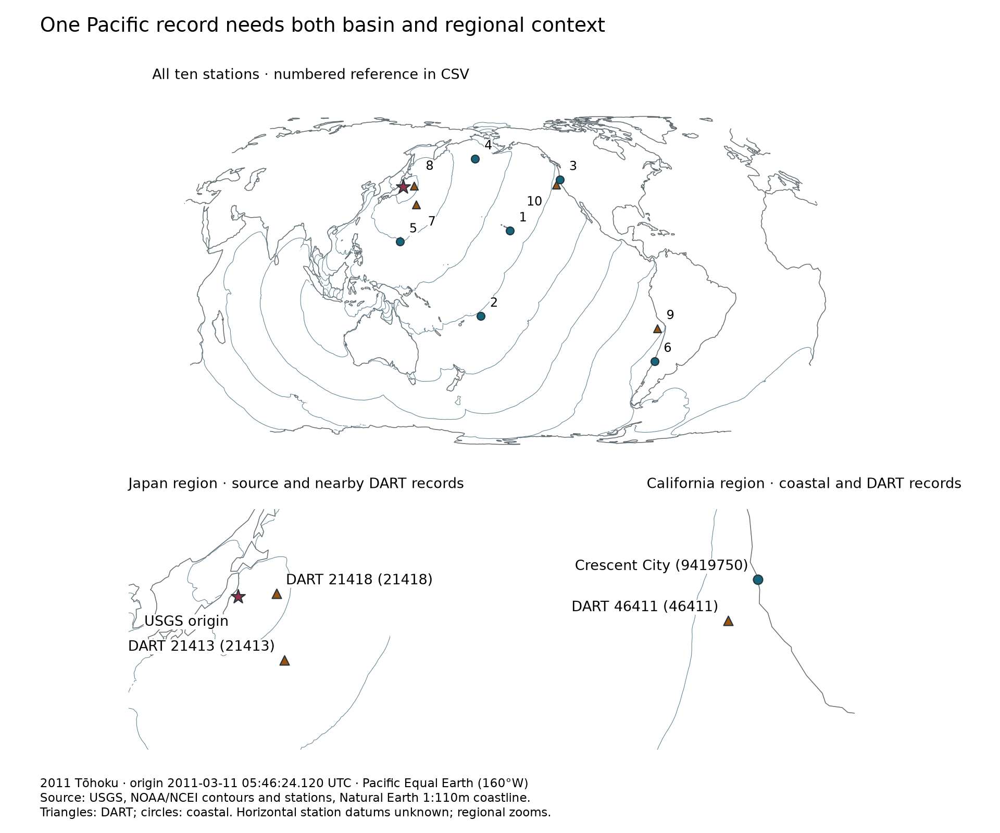
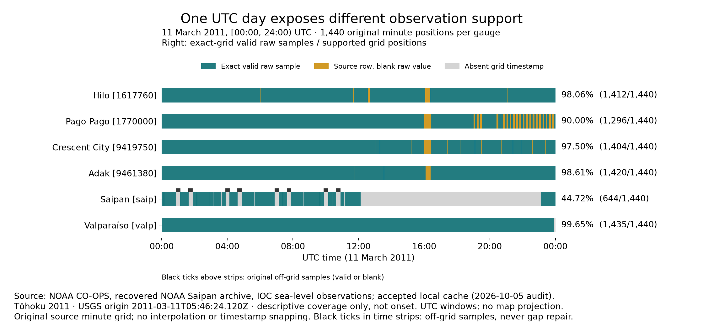
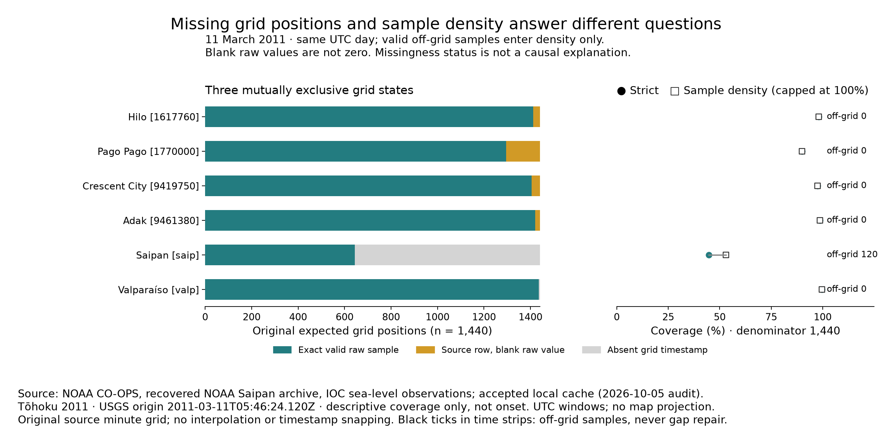
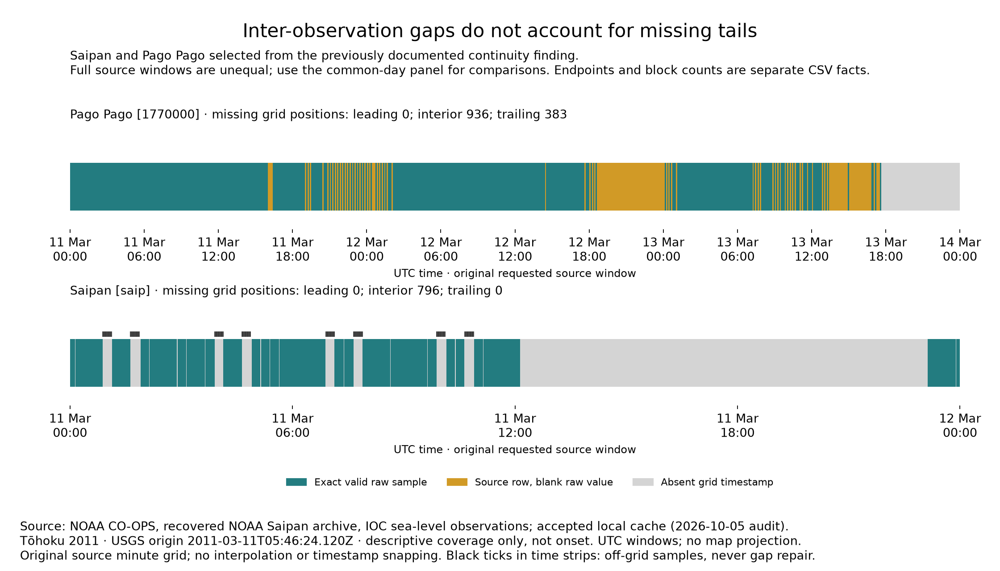
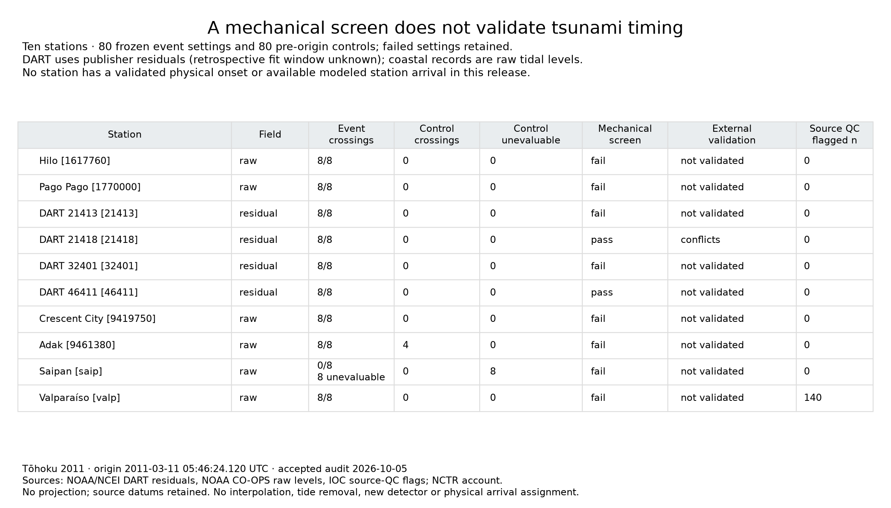
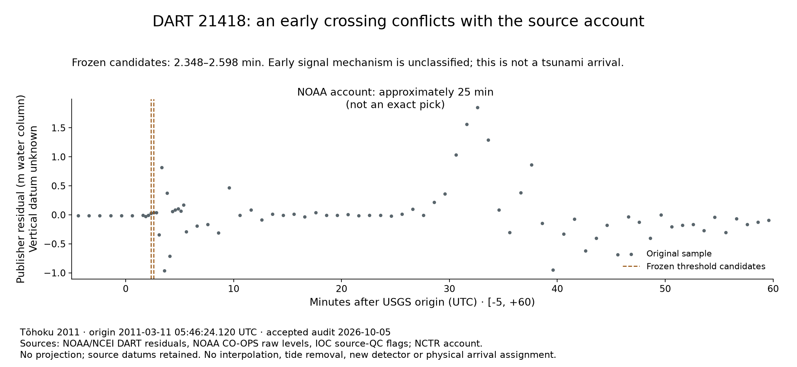
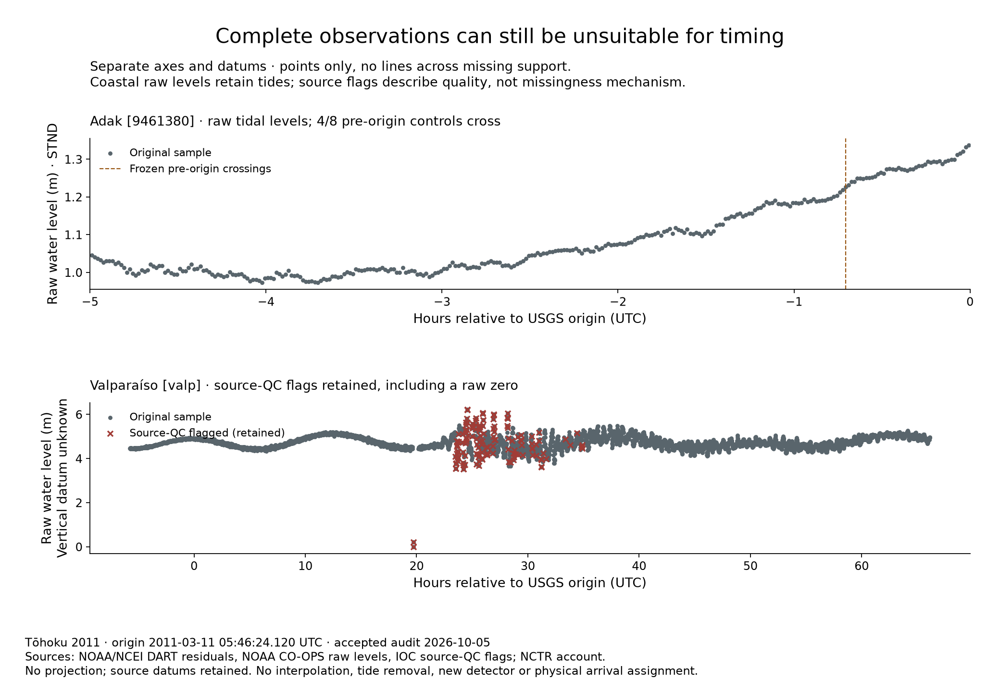
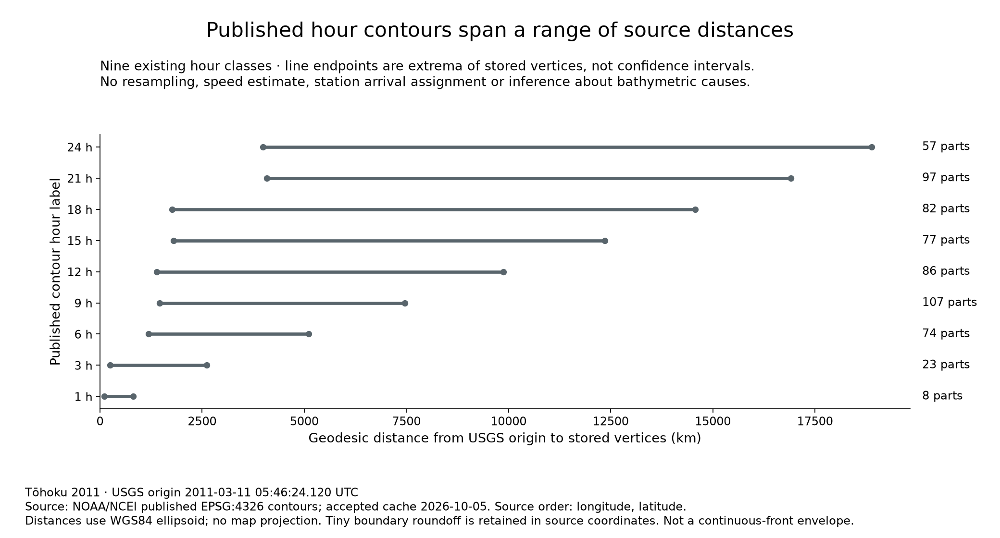

# Visual-story follow-up evidence

Run `2026-10-14-story-followups-v3` · implementation `c64e981d50f5c4bfc4eff8d5a315bc58cf376d94` · preliminary storyboard evidence.

Command: `uv run python scripts/story/build_followup_eda.py --tasks regional coverage signal contours synthesis --run-id 2026-10-14-story-followups-v3 --output artifacts/eda/story/followups/2026-10-14-story-followups-v3 --run-dir artifacts/logs/runs/2026-10-14-story-followups-v3`

## Scope and source boundary

One 2011 Tōhoku event, ten fixed stations, six coastal gauges. Origin:
2011-03-11T05:46:24.120Z (USGS). All selected source bytes were checked before
analysis. The continuous NCTR field is still unavailable; published NCEI hour
contours are not a replacement. This is retrospective, descriptive story work,
separate from paper modeling. No app assets, public scenes or arrival claims.

## Comparable coastal coverage

11 March 2011 [00:00,24:00) UTC; 1,440 original source-minute positions each.
Valid means numeric raw value present, not quality-approved. Blank is not zero.
Density counts valid off-grid samples but caps at the same denominator; they do
not repair the grid. Event-relative windows slice that original phase, never
re-anchor it to the fractional earthquake timestamp. Full windows are separate.

| Gauge | Exact valid / expected | Strict | Sample density | Off-grid n |
| --- | --- | --- | --- | --- |
| Hilo [1617760] | 1412/1440 | 98.0556% | 98.0556% | 0 |
| Pago Pago [1770000] | 1296/1440 | 90.0000% | 90.0000% | 0 |
| Crescent City [9419750] | 1404/1440 | 97.5000% | 97.5000% | 0 |
| Adak [9461380] | 1420/1440 | 98.6111% | 98.6111% | 0 |
| Saipan [saip] | 644/1440 | 44.7222% | 53.0556% | 120 |
| Valparaíso [valp] | 1435/1440 | 99.6528% | 99.6528% | 0 |

## Findings and thoughts

### F-07 — regional context

All 10 stations remain; required label overlaps: 0.

References: station-reference.csv;label-audit.csv. Decision: retain. Regions are zooms, not cohort exclusions; coarse coastline and unknown datums remain.

### F-08 — comparable coverage

Common-day strict rank: Valparaíso, Adak, Hilo, Crescent City, Pago Pago, Saipan. Full-requested-window rank: Adak, Hilo, Valparaíso, Crescent City, Pago Pago, Saipan.

References: coverage-by-window.csv. Decision: retain. Window duration affects support. Six fixed gauges are not a population sample.

### F-09 — missing support

Saipan strict 44.7222% versus density 53.0556%; 120 off-grid samples. Pago Pago trailing absent positions: 383.

References: gap-blocks.csv;off-grid.csv;coverage-by-window.csv. Decision: retain. A missing grid timestamp need not mean no raw sample. Causal missingness is unknown.

### F-10 — signal validity

160 frozen settings; DART21418 candidates 2.348–2.598min versus approximately25min source account. Adak controls 4/8; 140 flagged Valparaíso rows retained. Saipan event runs: 8 unevaluable (8 baseline failures), 0 evaluable no-detection outcomes.

References: signal-support.csv;setting-reference.csv;source-qc-reference.csv;source-references.csv. Decision: retain. Early signal unclassified; raw tides and retrospective residuals are not physical arrival picks.

### F-11 — contour geometry

611 parts, 13,223 stored vertices across 9 classes. 24h range: 3983.403–18885.599km.

References: contour-parts.csv;contour-distance-envelopes.csv. Decision: retain-secondary. Stored-vertex extrema are not probabilities, continuous-front bounds or station arrivals.

## Interpretation and limitations

Observability has the clearest current support for a visual story: archive
window and timestamp semantics change what a reader can see. It does not show
why measurements are absent. MCAR, MAR and MNAR cannot be identified from these
patterns alone; no instrumentation-age or collection-error cause is invented.
Acquisition failures, source blanks, missing timestamps, parser rejects and QC
are distinct. Accepted source bytes and earlier accounting remain available via
inputs.json; 107 previously rejected
records remain excluded, not repaired.

Signal interpretation is a useful guardrail, not a new timing result. The
early DART signal is unclassified; the NCTR account is approximate, not an exact
25-minute timestamp. Adak control UTC values are plotted relative to origin,
not their control-search elapsed field. Raw coastal tidal levels and publisher
retrospective residuals (fit window unknown) are not comparable onset fields.
Source flags are retained for inspection, not an invented exclusion algorithm.
Unknown datums stay unknown. No amplitude comparison across incompatible datums.

Geometry is secondary: fragmented stored parts, nonuniform sampling and unknown
continuous-front behavior limit interpretation. Geodesic extrema use WGS84 and
original source vertices, including tiny longitude boundary roundoff; they are
not probabilities or confidence intervals. No bathymetry was acquired or inferred.

## Decisions and next smallest questions

See story-question-evidence.csv for supporting/contradicting evidence and blocked
claims. Propose observability-first framing to the owner; no story pivot is
approved here. Retain signal limitations; stop contour analysis after this check.
At most two subsequent checks: (1) test a plain-language explanation of strict
versus density coverage (F-08/F-09); (2) test whether readers distinguish a
threshold crossing from a validated arrival (F-10). No further analysis is run.

Arrival comparison permission remains **false**; arrival-based story work is blocked.
These are analytical figures, not mobile-ready story components. At 400px,
check the thumbnail message only; detailed labels require the analytical view.

## Figures and reference tables

All ten stations remain visible at basin scale; regional zooms clarify Japan and California. References: [station-reference.csv](station-reference.csv), [label-audit.csv](label-audit.csv)

Six coastal gauges share 1,440 original minute positions on 11 March 2011 UTC. References: [coverage-by-window.csv](coverage-by-window.csv), [coverage-spans.csv](coverage-spans.csv), [off-grid.csv](off-grid.csv)

Source blanks, absent timestamps and off-grid samples have different counting semantics. References: [coverage-by-window.csv](coverage-by-window.csv), [gap-blocks.csv](gap-blocks.csv)

Saipan has a long internal gap; Pago Pago also has an absent trailing archive segment. References: [gap-blocks.csv](gap-blocks.csv), [coverage-spans.csv](coverage-spans.csv)

Mechanical screens do not validate physical onsets; all failed settings remain. References: [signal-support.csv](signal-support.csv), [setting-reference.csv](setting-reference.csv)

DART 21418 early unclassified threshold crossings conflict with an approximate NOAA account. References: [signal-windows.csv](signal-windows.csv), [source-references.csv](source-references.csv), [setting-reference.csv](setting-reference.csv)

Adak has pre-origin crossings; Valparaíso source flags and raw zero are retained. References: [signal-windows.csv](signal-windows.csv), [source-qc-reference.csv](source-qc-reference.csv), [setting-reference.csv](setting-reference.csv)

Published hour classes span overlapping ranges of source-vertex distances, not arrival predictions. References: [contour-parts.csv](contour-parts.csv), [contour-distance-envelopes.csv](contour-distance-envelopes.csv)

## Reproducibility

manifest.json records figure hashes, CSV references, dimensions, units, origin,
sources, projection, counts, command and implementation SHA. inputs.json hashes
the accepted evidence; outputs.json hashes all stable files except itself.
No randomness is used. Local MLflow recording is paired with a portable run
bundle; tracking receipt IDs are intentionally outside stable scientific files.
Independent QA and owner story selection are separate from this evidence bundle.
