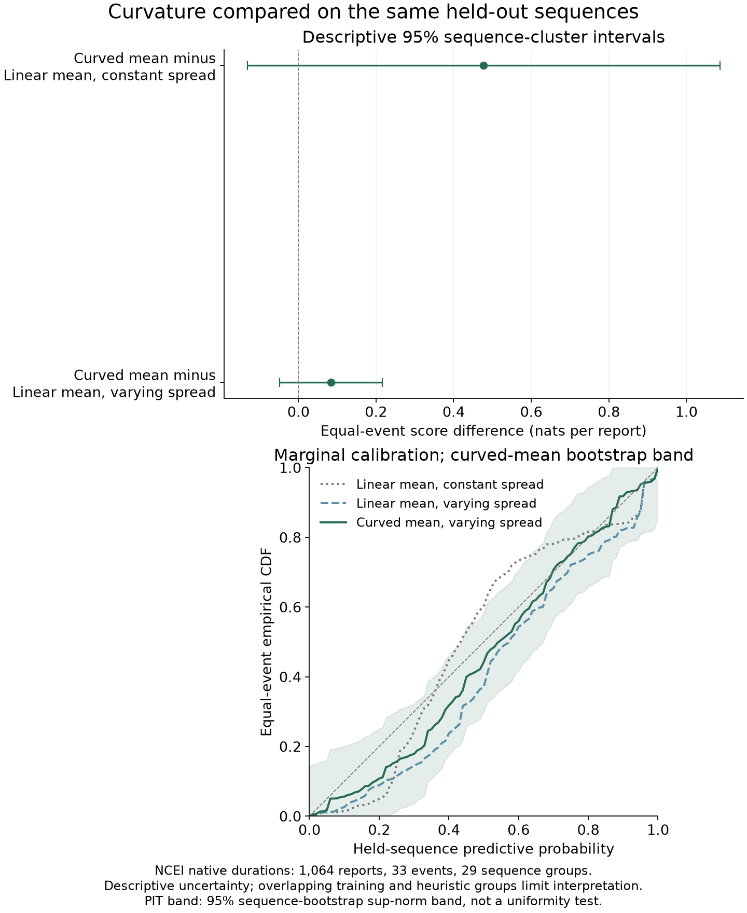

# Curvature and held-sequence prediction

The curved mean is compared with linear means using the same 1,064 NCEI reported durations, 33 events and 29 sequence holdouts. Each event's joint native-minute log predictive density is divided by its report count; these 33 values receive equal weight. Higher scores indicate better prediction for this reported-data target.

| Mean and spread | Equal-event score | Monte Carlo SE |
| --- | ---: | ---: |
| Linear mean, constant spread | -6.242640 | 0.000123 |
| Linear mean, varying spread | -5.849000 | 0.000112 |
| Curved mean, varying spread | -5.765108 | 0.000122 |

Curvature minus linear mean, constant spread is 0.4775 nats/report, with a descriptive 95% sequence-cluster interval [-0.1312, 1.0863].

Curvature minus linear mean, varying spread is 0.0839 nats/report, with a descriptive 95% sequence-cluster interval [-0.0487, 0.2165].

The curved mean adds gamma times log((d+500)/(1.5d)) to the log median ratio. Both varying-spread models use the same three fixed spread anchors. Gamma is a phenomenological curvature coefficient; it does not identify shelf delay, propagation physics or recording error. Its prior and this revisit were chosen after exploration EDA and earlier model criticism.

Tōhoku's direct bridge estimate failed the overlap checks despite clean posterior diagnostics. Its score is replaced by an independently accepted fixed-temperature normalizer path for the same model, prior and held-out data, with a fresh repeat. The original failed estimate and its training-only predictions remain unchanged. The native-duration Jacobian is applied once; numerical uncertainty is separate from between-sequence uncertainty. A finite Gaussian AR calibration experiment showed a small empirical shift in its finite cohort. Clean diagnostics and repeat agreement do not certify global posterior exploration.

LATA's one-report event in another sequence exceeded the original Monte Carlo precision screen despite adequate bridge overlap. Two fresh, longer ensembles for the same training data and LATA-only augmentation passed that screen. Its fold retains the other event's original score and every original prediction. Numerical variances for the old and fresh training streams add independently; the two events remain one sequence for sampling uncertainty. The reported 1,125-minute duration is unchanged.

Sumatra's 49-report event also failed direct-bridge overlap checks. Its score uses a separately accepted path for the same model and prior, with an independent repeat. All 80 reports in its three-event sequence were excluded from training. The other 22-report and 9-report event scores and all 80 original training-only predictions remain unchanged. The resolved fold combines the three shared-training influence vectors before estimating Monte Carlo variance, then adds independent later-path and augmented-stream variances. The native-duration Jacobian is already included once in the accepted event score; this comparison adds no Jacobian.

The paired intervals use sequence-cluster sandwich uncertainty with small-group t critical values. The metadata-defined groups and overlapping training sets limit interpretation. The PIT bands resample sequences and event counts together; they are descriptive rather than uniformity tests. Calibration tables also show fixed distance and seen/unseen geographic-site strata. A geographic repeat does not establish instrument continuity or transfer to new regions.

The actual full-exploration curved-mean fit still misses 8 of 15 correlated conditional predictive checks. The LATA 1,125-minute report remains in the data, well beyond its fitted-event 90% interval. Source-process flags are not proof that a value is wrong. Sensitivity analysis must precede any model selection or specification freeze. This comparison does not recover historical timestamp pairs or evaluate operational warnings.

The 19 previously inspected development-check events have not been reopened; the 18 reserved outcomes remain sealed. No source likelihoods are pooled or ranked against one another.

Tables: [model scores](model-scores.csv), [paired differences](paired-score-differences.csv), [event joint scores](event-joint-scores.csv), [sequence influence](sequence-score-influence.csv), [predictive strata](predictive-calibration-by-stratum.csv), [PIT](event-weighted-pit.csv).

Reproduce with `uv run --locked --offline python scripts/summarize_arrival_curvature_comparison.py --output <new-project-path>`. The complete independently accepted curvature continuation-v3 (128 calls, 26 direct folds and three reviewed resolutions) is required before any collection. Exact source, native-input and artifact hashes are in inputs.json and output-checksums.json.
