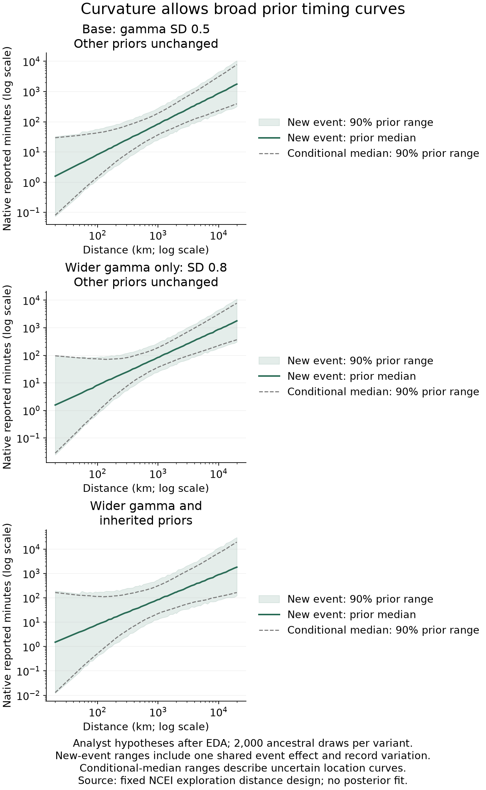

# Smooth mean-curvature prior checks

This is one exploration candidate for source-defined NCEI durations. The log response adds gamma times b(d) = log1p(500/d) − log1p(0.5) to the existing distance/event model, retaining its three distance-dependent SD anchors. The fixed basis is centered at 1,000 km. Gamma = 0 nests the preceding likelihood. Gamma describes reported-timing curvature; it is not a physical delay.

Three hypotheses separate widening gamma alone from widening all inherited priors. They use the same standard Normal draws for easier comparison, rather than independent Monte Carlo samples. These priors were specified after descriptive EDA.

The following multipliers and probabilities are analytic prior quantities. The diagnostic CSV uses 2,000 finite ancestral draws, so its empirical fractions can differ.

| Hypothesis | Gamma SD | Gamma-only 95% median multiplier at 100 km | Limiting near-distance probability of negative median elasticity |
| --- | ---: | ---: | ---: |
| base | 0.5 | [0.257, 3.891] | 3.7% |
| gamma_wider_only | 0.8 | [0.114, 8.790] | 11.6% |
| joint_wider | 0.8 | [0.114, 8.790] | 13.2% |

The local elasticity of the conditional median curve is 1 + beta − gamma × 500/(d + 500). At 1,000 km it is 1 + beta − gamma/3; beta and gamma can therefore trade off. The limiting negative-elasticity probability is a prior implication, not a claim about physical propagation. The basis also changes the far-distance intercept and is not a near-only adjustment.

At fixed hyperparameters, a new event has median duration t0(d) exp(m(d)) and mean duration t0(d) exp(m(d) + (sigma(d)^2 + tau^2)/2). The native mean elasticity additionally contains sigma(d) d sigma(d)/d log(d), away from the fixed SD anchors. The conditional-median range shown below mixes over coefficient uncertainty; the new-event range also includes event and record variation. An arithmetic mean across prior draws is not plotted.

The joint-wider hypothesis inherits an infinite native second moment from the wider event-SD prior. Finite Monte Carlo draws do not remove this fact. Quantiles are reported throughout. The soft ratio yardstick (below 0.05 or above 20 times the fixed reference) is descriptive and is not an automatic rejection threshold. Impossible or nonfinite generated values halt the run; no clipping or redraw is used.

Every original primary record remains eligible, including source-component flags. These checks authorize no repair or exclusion. The 19 previously inspected confirmation outcomes have not been reopened during implementation; the 18 reserved outcomes remain sealed. No candidate posterior has been fitted.

Recovery and SBC remain required before an actual candidate fit. Numerical success, plausible prior ranges and a flexible curve establish neither physical truth nor predictive superiority.

Tables: [parameter priors](parameter-prior-dictionary.csv), [native prior quantiles](new-event-duration-prior-quantiles.csv), [curve implications](mean-curve-prior-quantiles.csv), [design diagnostics](prior-diagnostics.csv).

The original render connected distances in text order. This version sorts distances numerically; every numerical table and saved ancestral array is unchanged.

Reproduce: `uv run --locked --offline python scripts/render_arrival_curvature_prior.py --bundle data/processed/models/mean-curvature-prior-unreviewed-v1 --output <new-project-path>`. Ancestral generation remains reproducible with the original input manifest and source version.
