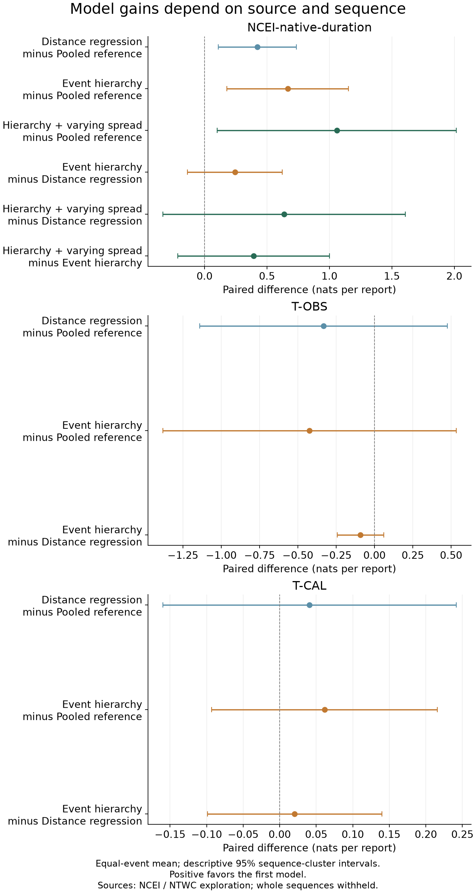
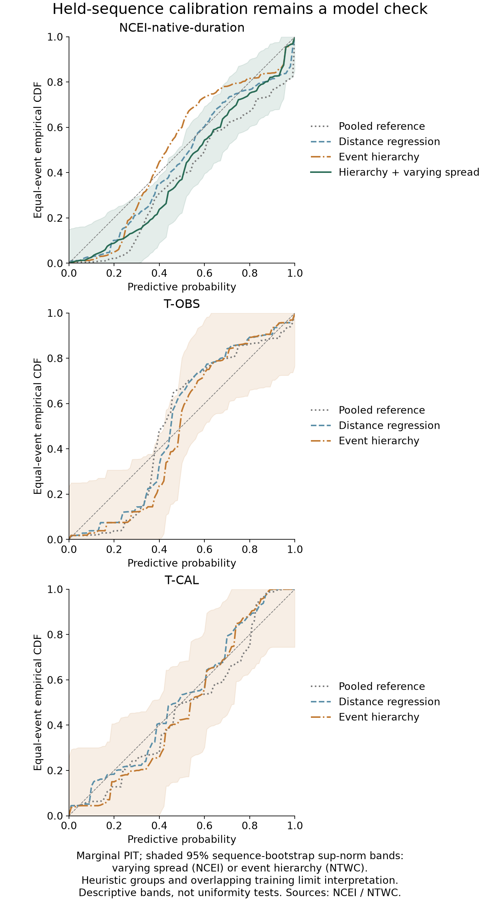

# Whole-sequence predictive comparison

These exploration comparisons predict reported timings for sequences excluded from training. Each event contributes its joint native-minute log predictive density divided by its number of reports; events then receive equal weight. Higher scores indicate better prediction within the same source and evidence cohort.

For both duration targets, every comparator already contains the fixed distance-based reference t0(d). Distance regression adds a learned log-distance adjustment; the event hierarchy adds partially pooled event offsets. The pooled T-CAL comparator has a constant signed-minute mean.

| Source | Model | Reports | Events | Equal-event score | Monte Carlo SE |
| --- | --- | ---: | ---: | ---: | ---: |
| NCEI-native-duration | Pooled reference | 1064 | 33 | -6.908627 | not applicable |
| NCEI-native-duration | Distance regression | 1064 | 33 | -6.485385 | not applicable |
| NCEI-native-duration | Event hierarchy | 1064 | 33 | -6.242640 | 0.000123 |
| NCEI-native-duration | Hierarchy + varying spread | 1064 | 33 | -5.849000 | 0.000112 |
| T-OBS | Pooled reference | 236 | 14 | -7.658167 | not applicable |
| T-OBS | Distance regression | 236 | 14 | -7.990432 | not applicable |
| T-OBS | Event hierarchy | 236 | 14 | -8.081797 | 0.000132 |
| T-CAL | Pooled reference | 156 | 13 | -5.001498 | not applicable |
| T-CAL | Distance regression | 156 | 13 | -4.960648 | not applicable |
| T-CAL | Event hierarchy | 156 | 13 | -4.940181 | 0.000189 |

For NCEI durations, varying spread has the highest score among these four models. Its paired gain over constant-spread hierarchy is 0.394 nats/report, with a descriptive 95% sequence interval [-0.214, 1.002]. This interval does not establish a clear advantage over that hierarchy.

Sequence `seq-usc000phx5` contains 2 events and contributes 0.301 nats/report to that 0.394 mean gain. Re-averaging the other 31 event scores gives 0.098. This deletes score contributions only: the other models were not refitted without this sequence. Source-field and whole-sequence sensitivity checks remain necessary before selection.

For reports under 500 km, the varying-spread model's equal-event 90% coverage estimate is 82.0% across 27 events. Together with the earlier conditional predictive discrepancies, this motivates the bounded mean-form revisit; broad overall coverage alone would hide this stratum.

For NTWC observed durations, hierarchy minus pooled reference is -0.424 [-1.382, 0.534]. For signed timing differences, hierarchy minus distance regression is 0.020 [-0.099, 0.140]. Neither establishes a clear predictive gain. No specification is selected here.

Scores from different sources have different response definitions and cannot be ranked against one another. T-OBS is observed UTC minus reviewed earthquake origin in minutes. T-CAL is estimated UTC minus observed UTC in signed minutes. The two share the observed clock and remain separate analyses. NCEI durations retain their native reported definition; no common physical onset is assumed.

The paired table reports each model difference with a descriptive sequence-cluster sandwich standard error and a 95% t interval. The small, metadata-defined sequence groups and overlapping training sets limit their interpretation. Numerical Monte Carlo errors and deterministic integration error estimates are recorded separately. The latter are refinement diagnostics, not rigorous error bounds. A 0.01-nat reporting yardstick does not define a model-promotion rule or a Bayes factor.

Calibration tables give both record-weighted summaries and equal-event averages. Distances use fixed 500, 2,000 and 5,000 km cut points. Seen geographic sites need not be continuous instrument deployments; unseen-site performance does not establish transfer to new regions. Interval widths and absolute errors are in native minutes. The PIT sequence bootstrap resamples sequence totals and event counts together. Its bands are descriptive and conditional on the retained predictions, not uniformity tests.

Sequence influence rows remove score contributions without refitting models. They complement the later explicit influential-event refits. Full-exploration posterior predictive checks and sensitivity analysis remain necessary before any specification freeze.

The 19 previously inspected EDA confirmation events have not been reopened here; the 18 reserved outcomes remain sealed. These comparisons do not establish operational warning accuracy, missing timestamp recovery or independent transport to new eras.

Reproduce with `uv run --locked --offline python scripts/summarize_arrival_sequence_validation.py --output <new-project-path>`. The command requires all 83 logical sequence calculations and their independent acceptance receipt. Exact inputs and output hashes accompany this report.

Tables: [model scores](model-scores.csv), [paired differences](paired-score-differences.csv), [event joint scores](event-joint-scores.csv), [sequence influence](sequence-score-influence.csv), [predictive strata](predictive-calibration-by-stratum.csv), [event-weighted PIT](event-weighted-pit.csv).
