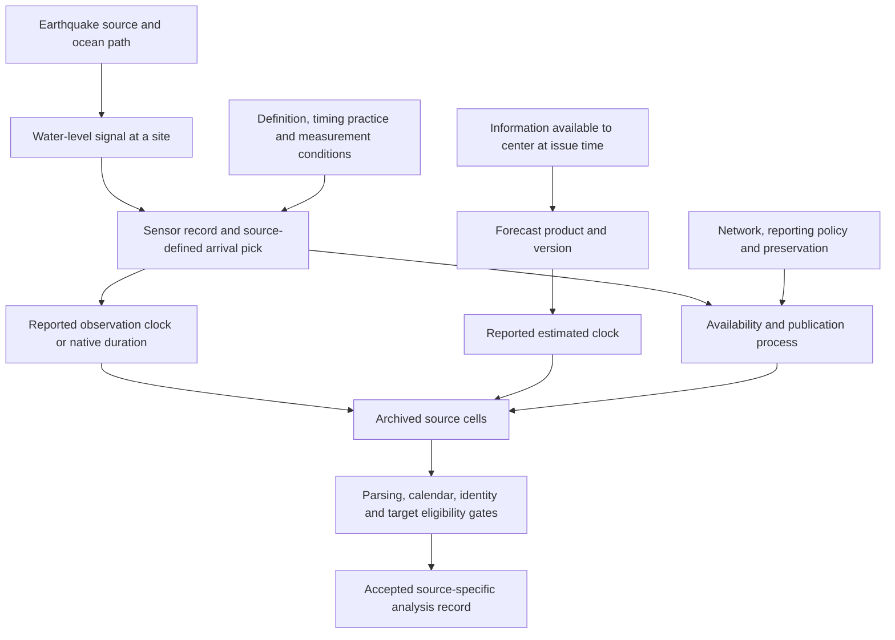

# From arrival-timing EDA to a Bayesian model

The data support starting with a model of **reported travel durations**, with
distance and event variation as the first scientific components to investigate.
They do not yet support treating every reported time as a validated physical
onset, pooling the archives as independent measurements, or estimating a large
event–station–source hierarchy with confidence.

This is the pre-modeling bridge from the [completed EDA](../../artifacts/eda/arrival-timing/README.md).
The new [design findings](../../artifacts/eda/arrival-timing/pre-modeling-design/design-findings.md)
use only its frozen exploration tables. They are posthoc exploratory diagnostics;
the earlier confirmation findings retain their original status. Initial prior
hypotheses and their simulations are now available below. Initial exploration
fits for all three source targets have passed numerical and conditional-predictive
replay. No reserved event outcome is opened.

The approach follows Chris Fonnesbeck's [PyMC modeling workflow](https://github.com/fonnesbeck/pymc-agent-skills/blob/main/skills/pymc-modeling/references/workflow.md)
and [prior-elicitation skill](https://github.com/fonnesbeck/pymc-agent-skills/blob/main/skills/prior-elicitation/SKILL.md):
define the target and observation process, expose assumptions in meaningful units,
then test their implications before fitting. EDA cannot establish all the details
of a latent process; simulation and model criticism will resolve some questions
that more descriptive plots cannot.

## Reproduce the model-data contract

The model data builder reads three hash-pinned exploration tables and outcome-free
metadata. It exports source rows, model inclusion decisions and exact
leave-one-sequence-out folds. It does not parse confirmation or reserved outcomes.

```bash
uv sync --locked
uv run python scripts/arrival_model.py data --output /tmp/arrival-model-data
uv run python scripts/arrival_model.py lineage --receipt /tmp/arrival-repeat-review.json
uv run python scripts/arrival_model.py stack \
  --store /tmp/arrival-synthetic.nc --receipt /tmp/arrival-stack.json
```

Use new output paths for each run. Add `--register` to the data command to log
the bundle in the project-local `arrival-model` MLflow experiment. If registration
fails after the bundle is written, use `arrival_model.py register --bundle PATH`;
it checks for an existing receipt/run before retrying. The stack command fits
known synthetic values to test nutpie, predictive APIs and NetCDF serialization.
It provides no scientific arrival-model result.

The [contract](../../config/arrival-model-contract-v1.toml) preserves 1,070 NCEI,
236 NTWC-duration and 156 timing-discrepancy exploration rows. The primary NCEI
view uses **1,064 rows**: all six records on three repeated event/site edges are
withheld together because their measurement ancestry is unresolved. This rule
uses identity, rather than agreement or residual size. No source value is changed.
The [source review](../../artifacts/models/arrival-timing/repeated-edge-source-review.json)
records the native IDs for Midway (2007 Peru), Makapuu (2012 Haida Gwaii) and
Naha (2011 Tōhoku); distinct catalog IDs do not prove independent measurements.
Representative-record or dependence sensitivities remain future checks. Two
previously flagged definition-conflict candidates stay included as native reports,
with an explicit exclusion sensitivity required before final model selection.

The [data bundle](../../artifacts/models/arrival-timing/exploration-contract-v1/contract.json)
contains the scientific contract, source/input/code identities and record-level
folds. All rows from a related source sequence leave training together; held-out
site familiarity is computed from training rows only. The fixed predictor
`ln(distance_km/1000)` uses no empirical centering across folds. Display precision
is retained as metadata; it does not become an invented arrival-accuracy bound.

## Initial models and prior predictions

The implemented scaffolds compare a pooled intercept, a distance regression and
a distance regression with partially pooled event effects. For durations the
response is `ln(y/t0(d))`; for T-CAL it is the signed difference in minutes.
Every source gets its own model. Training graphs contain only their selected
rows and event coordinates.

The [prior dictionary](../../artifacts/models/arrival-timing/prior-checks-v1/parameter-prior-dictionary.csv)
and [assumptions](../../artifacts/models/arrival-timing/prior-checks-v1/prior-assumptions.md)
describe analyst scale hypotheses chosen after EDA. They are not expert beliefs
or measured wave-speed constraints. The duration base uses Normal priors with
SDs 0.5 and 0.25 for intercept and slope, and HalfNormal(0.4) priors for event
and record SDs. The intercept implies a central 95% interval of 0.375–2.664 for
the conditional median/reference ratio at 1,000 km and zero event effect.
The signed-minute model has separately specified scales.

Six ancestral checks use 2,000 draws each across the three targets and two prior
settings. The [figure](../../artifacts/models/arrival-timing/prior-checks-v1/new-event-prior-predictions.png)
shows new-event medians as lines and central 90% intervals as shaded bands,
conditional on distance. All predictions were finite and durations positive;
their breadth is an assumption to examine, not evidence of predictive accuracy.
The wider duration sensitivity has infinite predictive variance under its joint
prior, so it is summarized by quantiles. The base has finite first and second
moments. A finite Monte Carlo sample alone cannot establish those moment claims.

```bash
uv run python scripts/arrival_model.py priors \
  --output /tmp/arrival-prior-checks \
  --store data/processed/models/my-prior-checks
```

This command saves ancestral draws in the ignored store and writes portable
tables, figures, input hashes, seeds and a local MLflow receipt. It does not fit
a scientific posterior. Design recovery, inference calibration, real-data
diagnostics and grouped predictive validation remain required.

## Test inference on known simulated effects

The Gaussian event model supports three equivalent calculations: explicit
non-centered effects, explicit centered effects, and an exact integral over
the Normal event effects. The last samples four population parameters and then
draws each event effect from its exact conditional Normal distribution. It keeps
the hierarchy and its uncertainty. Tests compare the joint density, gradients
and conditional draws against independent Gaussian calculations.

The marginal form uses a [PyMC Potential](https://www.pymc.io/projects/docs/en/stable/api/model/generated/pymc.model.core.Potential.html).
Its predictions require explicit forward simulation; calling an automatic
predictive sampler on the Potential alone would omit the response mechanism.
The prior checks above use the equivalent explicit generative model. Every
representation rebuilds its training subset, with held-out mutation tests.

For a reproducible synthetic pilot, save this JSON as `/tmp/arrival-pilot.json`:

```json
{"phase":"pilot","target":"NCEI-native-duration","parameterization":"marginal",
 "seed":20261108,"draws":1000,"tune":1000,"cores":2,
 "truth":{"alpha":0.15,"beta":-0.05,"tau_event":0.2,"sigma":0.3}}
```

```bash
uv run python scripts/run_arrival_model_validation.py \
  --job /tmp/arrival-pilot.json --output /tmp/arrival-validation/pilot \
  --store data/processed/models/my-synthetic-pilot.nc --timeout 600
```

Use new attempt paths. The supervisor preserves failed fits, stops the process
group on timeout or interruption, and checks a `STOP` file in the output parent.
Exit status 2 means diagnostic screens failed; inspect the result and retained
chains before attempting a repair. A successful pilot is computational evidence
for this simulated case. Repeated design recovery and simulation-based calibration
are still needed before real-data inference; neither establishes physical truth.

The finite primary-source validation runner predefines 270 design-recovery
datasets (nine scenarios, 30 each) and 200 prior-generated calibration datasets.
It runs one fit at a time with two sampler cores, a ten-minute fit timeout and
separate call/storage ceilings. A mild precision failure permits one larger fit
of the same dataset; unsafe diagnostics stop for review. Failed attempts remain
in the record and never become replacement datasets.

```bash
uv run python scripts/run_arrival_model_batch.py --phase recovery \
  --output artifacts/models/arrival-timing/my-design-recovery \
  --store data/processed/models/my-design-recovery \
  --state context/runs/arrival-model-validation-v1/my-recovery-state.json
```

Use `--phase sbc` with separate new paths for calibration. `--max-cases 1`
limits a rehearsal to one completed dataset; `--resume` continues the identical
plan after an ordinary invocation limit. Source changes, unfinished attempts,
corrupt counts or unsafe failures require reconciliation. A `jobs/STOP` file
inside the output requests a stop. Computational completion remains separate
from scientific acceptance of recovery and calibration results.

Build portable recovery tables and figures from the retained trials:

```bash
uv run python scripts/summarize_arrival_model_validation.py \
  --batch artifacts/models/arrival-timing/my-design-recovery \
  --output artifacts/models/arrival-timing/my-recovery-summary --register
```

The command verifies each posterior hash and checks saved means against the
original draws. It preserves trial counts, failed attempts, interval coverage
uncertainty and a separate additive-time stress scenario. For SBC it reports
six quantities with simultaneous reference bands and MCMC caveats. Detailed
worker logs and posterior arrays remain local; portable tables, figures,
plans and checksums are committed. Registration uses project-local MLflow.

The [primary computational review](../../artifacts/models/arrival-timing/inference-validation-acceptance-v1.json)
accepted 270 recovery datasets and 200 calibration datasets in 471 attempts.
One calibration trial needed the predefined longer same-dataset run; every
attempt remains retained. The [recovery findings](../../artifacts/models/arrival-timing/design-recovery-summary-v1/findings.md)
and [calibration findings](../../artifacts/models/arrival-timing/inference-calibration-summary-v1/findings.md)
include the tables and figures. No calibration curve crossed the approximate
simultaneous reference band; this does not prove physical validity or accuracy.

The difficult weak-event/wide-record scenario had only 23/30 coverage for sigma,
with substantial simulation uncertainty. A separate 30-dataset follow-up is
required before model selection. Adding five minutes to simulated durations
severely biased the simpler model's location and distance terms; a clean sampler
can fit a misspecified model. These checks permit the first NCEI exploration
fits. Other source lanes require their own computational checks.

## First exploration fits and what they miss

The [baseline report](../../artifacts/models/arrival-timing/exploration-baseline-report-v1/baseline-findings.md)
contains three NCEI fits, parameter tables, distance-conditioned predictive
checks and event intervals. Independent replay accepted their computations and
conditional checks as exploratory results. All three passed numerical screens.
No model has been selected. The numerical comparator results below are separate
from these conditional fitted-event checks.

The event model estimates a between-event log-ratio SD of 0.352, with central
90% posterior interval [0.220, 0.510]. That variation can combine source, clock,
path and reporting differences. It does not identify physical propagation delay.
The constant record SD leaves substantial discrepancies: at distances of at
least 5,000 km, observed log-ratio 5–95% quantiles are [−0.111, 0.169], compared
with median replicated quantiles [−0.645, 0.637]. The middle-distance median
also needs attention. This motivates a bounded distance-dependent spread and
mean investigation, followed by sequence-held-out prediction and sensitivity.

The [recovery follow-up](../../artifacts/models/arrival-timing/design-recovery-followup-comparison-v1/followup-findings.md)
is complete. It retains the initial and new cohorts and explains why their
pooled interval is descriptive after adaptive scenario selection. Priors were
not changed to force nominal conditional coverage.

Separate [NTWC duration fits](../../artifacts/models/arrival-timing/source-baseline-report-v1/T-OBS/baseline-findings.md)
use 236 records from 14 events. The [signed discrepancy fits](../../artifacts/models/arrival-timing/source-baseline-report-v1/T-CAL/baseline-findings.md)
use 156 records from 13 events and preserve all 125 negative values. Each has
its own pooled, distance and event model. Their source-specific computational
checks use 30 recovery datasets and 30 prior-generated calibration datasets per
target; these small checks have substantially lower sensitivity than the primary
NCEI calibration exercise. They do not certify conditional coverage or physical
arrival accuracy.

The NTWC models also leave predictive discrepancies. In particular, the signed
model does not reproduce the far-distance negative tail and positive upper
quantiles together. Its variation can combine forecast, observation, clock and
archive effects. These results support further model criticism, with source
likelihoods kept separate; they establish neither a selected model nor held-out
or operational forecast performance.

## Investigate distance-dependent report variation

One NCEI candidate keeps the distance/event mean and lets residual SD vary
between fixed anchors at 500, 2,000 and 5,000 km. It interpolates SD linearly in
log distance and holds the endpoints constant outside the anchors. No monotonic
trend is imposed. These distances reuse exploration thresholds; this is an
adaptive development choice, with no new confirmation look.

The [candidate prior checks](../../artifacts/models/arrival-timing/distance-scale-prior-v1/prior-assumptions.md)
explain its independent HalfNormal(0.4) anchor priors and their observable
implications. Equal anchors reproduce the baseline likelihood, while the joint
prior differs. Interpolation reduces expected residual variance between anchors;
it does not supply a physical noise model or measurement-accuracy estimate.

Computational checks use 45 recovery datasets (15 each for constant, decreasing
and nonmonotone spread) and 100 prior-generated calibration datasets. All 145
passed on their first attempt and were independently replayed. Recovery coverage
is imprecise at 15 replicates per setting. The eight calibration quantities are
correlated; their approximate simultaneous reference band has limited sensitivity.
The [recovery report](../../artifacts/models/arrival-timing/distance-scale-validation-report-v1/recovery/findings.md)
and [calibration report](../../artifacts/models/arrival-timing/distance-scale-validation-report-v1/sbc/findings.md)
describe the checks and uncertainty. These results permit a candidate fit;
they establish neither adequacy nor predictive superiority.

The [candidate fit and figures](../../artifacts/models/arrival-timing/distance-scale-fit-report-v1/findings.md)
show much less far-distance residual variation: posterior median SD is 0.101
at 5,000 km, compared with 0.675 and 0.703 at the two nearer anchors. The
between-event SD falls to 0.046 [0.029, 0.084], compared with 0.352 under constant
spread. This change shows how strongly the attribution of variation depends on
the residual model. It does not establish that events have little physical
variation. Near- and middle-distance predictive discrepancies remain, and the
small event SD needs sensitivity checks.

Sequence-held-out comparisons retain native-minute joint event densities and
equal-event weighting. An extreme single-report event exposed excessive score
Monte Carlo error for the pooled comparator despite clean sampling. Both allowed
sampling attempts are retained. The planned Gaussian coefficient integration and
one-dimensional SD quadrature provide an alternative numerical route to the same
score.

All six pooled and distance-only comparator calculations are now complete in
the [analytic comparator bundles](../../artifacts/models/arrival-timing/analytic-gaussian-baselines-v1/).
Independent replay checked 108 whole-sequence training fits, 120 joint event
scores and 2,912 record predictions. These calculations preserve the original
priors, native-minute density and equal-event weighting. Deterministic numerical
error is reported separately from uncertainty across events and sequences.

All 83 hierarchical sequence calculations are complete and
[independently verified](../../artifacts/models/arrival-timing/bridge-sequence-continuation-v2/review-acceptance.json).
Together with the analytic comparators, the
[comparison report](../../artifacts/models/arrival-timing/sequence-predictive-comparison-v1/findings.md)
contains 191 logical sequence fits, 213 joint event scores and 5,432 record predictions.
Every duration comparator includes the fixed distance reference t0(d); distance
regression learns an additional adjustment. T-CAL uses its separate signed-minute
response and a constant-mean pooled comparator.

For NCEI durations, varying spread has the highest point score among the four
compared models. Its gain over the constant-spread hierarchy is 0.394 nats/report,
with a descriptive 95% sequence-cluster interval [−0.214, 1.002]. One two-event
sequence contributes 0.301 to that gain; re-averaging the other 31 event scores
gives 0.098. This removes score contributions only, without refitting the models.
The influential sequence contains a native record flagged for possible disagreement
between arrival-clock and travel-duration components. A consistently applied
source-field audit is pending; actual influential-sequence refits also remain
necessary before selection.

The varying-spread model substantially narrows the excessively broad far-distance
predictions. Its equal-event 90% coverage estimate below 500 km is 82.0% across
27 events, so overall coverage does not resolve the near-distance discrepancies.
These results motivate the bounded mean-form revisit. For T-OBS, hierarchy minus
pooled reference is −0.424 [−1.382, 0.534]; for T-CAL, hierarchy minus distance
regression is 0.020 [−0.099, 0.140]. Neither establishes a clear predictive gain.
Scores from different sources cannot be ranked against one another. No
specification is selected by this report.

Clean posterior chains did not always provide precise joint predictive densities.
Seventy-five hierarchical folds use direct bridge calculations; eight use reviewed
numerical alternatives to evaluate the same frozen model, priors and score.
The original failed estimates remain unusable and retained. Fixed-path calculations
integrate each held event's shared new effect before powering its likelihood and
retain covariance from shared training samples. Known-Gaussian path calibration
retained an unexplained negative mean error in its 30-trial autocorrelated cohort;
successful independent actual-data repeats do not remove that qualification.
Deterministic integration refinement estimates are reported separately from Monte
Carlo error and are not rigorous error bounds. These numerical resolutions recover
no missing historical forecast or arrival timestamp.

The report keeps native-minute joint scores, paired sequence uncertainty,
interval coverage and width, absolute error, and PIT calibration distinct. The
small heuristic sequence groups and overlapping training sets limit interval and
bootstrap interpretation. Comparisons remain conditional on archive reporting,
evidence eligibility and the retained geographic support. The 19 previously
inspected confirmation events have not been reopened during implementation;
18 reserved outcomes remain sealed. Sensitivity analysis precedes specification
freeze and the one-time development check. These results establish neither
warning-system performance nor transfer to new regions.

## What exactly would we predict?

| Candidate target | Unit and population | Interpretation and boundary |
| --- | --- | --- |
| NTWC reported duration, `T-OBS` | Minutes from reviewed USGS origin to reported observed UTC, among eligible archived reports | Predict the source-defined reported duration. Physical onset, original-center origin and clock accuracy remain uncertain. |
| NCEI native duration | Positive minutes as supplied by NCEI, among eligible archive records | A separate reported-duration task with more event/site support. Native definitions and possible shared ancestry remain material. |
| NTWC estimate minus observation, `T-CAL` | Signed minutes among eligible paired archive entries | Retrospective timing discrepancy. Negative means the estimate was earlier. Prospective forecast calibration also needs original issue/version/cutoff evidence. |

These are conditional archive populations, not a probability sample of all
tsunami–station opportunities. A model fitted to complete eligible records
initially describes those records. Transport to unreported arrivals or other
networks requires additional assumptions and evidence.

**Proposed first development lane:** NCEI native durations provide the largest
design for testing a modest reported-duration hierarchy. Repeat the scientific
question separately on NTWC durations as a source-specific comparison. If the
paper's central question must instead be historical forecast error, choose
`T-CAL` explicitly and accept its smaller event count and forecast-provenance
limitations. This is a recommended starting order, not a selected model or a
change in the scientific target. Keep all three source views intact.

## How the observed values are generated



This is a conceptual measurement/reporting diagram, not an identified causal
DAG. Unmeasured signal strength or selection could connect several boxes. The
[source-process evidence](../data/source-process.md) supports some publication
policies and four individual absent-observation explanations; it does not assign
a cause to every missing timestamp.

For an explicit latent model, let `theta` denote population parameters, `u_e`
event departures, `v_s` site departures, `q` an arrival definition, and `a_es`
a latent time with that declared definition. A candidate factorization is:

\[
p(\theta)\prod_e p(u_e\mid\theta)\prod_s p(v_s\mid\theta)
\prod_{es}p(a_{es}\mid d_{es},u_e,v_s,q,\theta)
\prod_j p(o_j\mid a_{e(j)s(j)},q_j,\theta).
\]

The last product is over governed evidence units. Copies or reports derived
from the same waveform cannot silently become independent likelihood factors.
Our simpler first reported-duration model would collapse unresolved physical,
pick and reporting variation into a conditional distribution of the **reported
quantity**. It would not claim to identify these latent layers separately.

For selection, distinguish `R` (a value is published), `P` (its meaning/calendar
is resolved), and `G` (identity and target requirements are met). The usable
record indicator combines these stages. The archive does not enumerate every
station that could have reported, so there is no justified all-station Bernoulli
denominator. Within preserved records we can describe availability; dependence
on unobserved arrivals remains unidentified. Missing observations are not
right-censored arrivals unless actual detection and monitoring bounds establish
that mechanism. MCAR/MAR/MNAR remain hypotheses, not EDA classifications.

## What the new design checks add

| Exploration target | Rows / events / sites | Unique event–site edges | Independent graph cycles | Within-event share of log-distance variation |
| --- | ---: | ---: | ---: | ---: |
| NTWC duration | 236 / 14 / 160 | 236 | 65 | 79.6% |
| NCEI duration | 1,070 / 33 / 439 | 1,067 | 597 | 68.5% |
| Estimate minus observation | 156 / 13 / 95 | 156 | 51 | 68.8% |

Source: [structural design table](../../artifacts/eda/arrival-timing/pre-modeling-design/event-station-contrast-support.csv).
For `E` events, `S` sites and `C` connected components, the additive event/site
indicator matrix has rank `E + S − C`. With `M` unique edges, cycle surplus is
`M − E − S + C`. These graph cycles are a structural redundancy count, not
independent tsunami realizations, posterior effective sample size, or a test of
random-effect variance identification. The three repeated NCEI edge rows require
an evidence-lineage decision before likelihood construction.

Distance varies substantially within events, which gives a distance term support
beyond event identity. This fraction is not explained outcome variance and does
not establish a slope or its sign. Magnitude, depth, era, region, mechanism and
table format have no within-event variation in these samples. Their effects are
exactly aliased with unrestricted event indicators. A hierarchical event-level
regression can make additional exchangeability assumptions, but its information
comes from 14, 33 or 13 events, not hundreds of independent event-level records.
The [alias table](../../artifacts/eda/arrival-timing/pre-modeling-design/event-intercept-covariate-aliases.csv)
retains missing mechanism values; `unknown` is not a physical mechanism.

If one event is withheld, the fraction of its rows at sites observed in another
exploration event is 52.1% for NTWC duration, 78.8% for NCEI duration and 62.2% for
the signed discrepancy, weighting rows equally. Weighting held-out events equally
gives 66.6%, 86.5% and 74.6%. This difference reflects event-size composition.
The [per-event table](../../artifacts/eda/arrival-timing/pre-modeling-design/event-holdout-seen-site-support.csv)
supports both summaries. Geographic identity does not establish deployment
continuity. These are event-deletion design checks, not validation scores or a
physical-sequence holdout design.

## A candidate equation with interpretable parameters

Use one parameterization consistently. Let `t0(d)` be the fixed 4,000 m-depth
reference duration in minutes, with distance in km:

\[
t_0(d)=\frac{1000d}{60\sqrt{9.80665\times4000}},\quad
x=\log(d/1000),\quad r=\log(y/t_0(d)).
\]

For each archive separately, a candidate conditional model is:

\[
r_i\sim\mathcal N(\mu_i,\sigma_i^2),\qquad
\mu_i=\alpha+\beta x_i+u_{e(i)}\;[+v_{s(i)}],
\]
\[
u_e\sim\mathcal N(0,\tau_E^2),\quad
v_s\sim\mathcal N(0,\tau_S^2),\quad
\log\sigma_i=\eta_0\;[+\kappa x_i].
\]

Square brackets identify later components to investigate, not an instruction
to include them all. A near-field term or a small smooth distance function is
another branch if the baseline misses the documented near-field behavior.
The constant-depth reference is a diagnostic offset, not a bathymetric solver
or a known prediction with independent validation.

| Quantity | Meaning | Information and main limitation |
| --- | --- | --- |
| `alpha` | Log median ratio to `t0` at 1,000 km, for zero event/site effects | `exp(alpha)` is a timing multiplier; its interpretation depends on reference and group centering. |
| `beta` | Change in log ratio per unit log distance | Total duration exponent is `1 + beta`; a distance doubling changes the ratio by `2^beta`. Within-event distance varies, but slope evidence still needs a model. |
| `tau_E` | SD of event departures on log scale | Learnable information comes from the contributing events and their overlap; exchangeability and event composition matter. |
| `tau_S` | SD of persistent site departures on log scale | Geographic repeats are present, but existing median-polish/bootstrap diagnostics do not establish a stable variance decomposition or deployment continuity. |
| `sigma = exp(eta0)` | Conditional log spread left by the specified model | Mixes omitted path, pick and reporting variation; it is not automatically sensor noise. |
| `kappa` | Log-spread change per log-distance unit | Candidate response to distance-dependent spread; mean misspecification can imitate heteroskedasticity. |
| `b_q`, origin offsets, pick-error scales | Definition or timing effects in declared minutes or log units | Separating these from process spread needs independent evidence, repeated compatible measurements, or explicitly labeled sensitivity assumptions. |
| `nu`, if a signed Student-t is used for `T-CAL` | Tail-shape parameter | Sparse event support may leave it prior-sensitive; the scale parameter is not the SD. |

For a Normal log-ratio distribution at **fixed parameters and group effects**,
the conditional median is `t0 exp(mu)` and mean is `t0 exp(mu + sigma²/2)`.
If instead writing `log(y / 1 minute) = a + gamma log(d/1000) + …`, then
`a = log(t0(1000) / 1 minute) + alpha` and `gamma = 1 + beta`.
This distinction prevents interpreting a log-minute intercept as a reference ratio.

The [scale translation table](../../artifacts/eda/arrival-timing/pre-modeling-design/hypothetical-log-scale-translation.csv)
shows assumed conditional log SDs. For illustration, `sigma=0.25` gives a central
90% interval of approximately **0.663–1.509 times the conditional median**;
`sigma=0.5` gives **0.439–2.276 times**. These are teaching scenarios, not priors,
estimates or full posterior-predictive intervals. Uncertain coefficients and
new-group effects add further spread.

## Observation likelihoods and tails need separate decisions

**Rounding:** if documentation supports rounding a continuous reported time to
an interval `[L,U]`, its likelihood contribution is `F(U)-F(L)`, using stable
log-CDF arithmetic. A nearest-minute rule would imply a hypothetical ±0.5-minute
bin, but display precision alone does not prove that rule or accuracy. Clipping
a lower bin edge at zero expresses positive support, not permission to discard
the record. Truncating the population and integrating an observation bin are
different operations.

The [clock-width scenarios](../../artifacts/eda/arrival-timing/pre-modeling-design/hypothetical-clock-width-sensitivity.csv)
show why short durations deserve attention: a hypothetical ±0.5-minute bin is
at least 10% of duration for 2/236 NTWC and 5/1,070 NCEI exploration rows; one
NTWC duration is itself below 0.5 minute. These counts do not assign uncertainty,
repair the clock, or justify dropping those rows. Origin error is shared within
an event and additive in minutes; it should not be hidden as independent
per-record log noise when material.

**Shared clocks:** `T-OBS = O − Q` and `T-CAL = E − O` share the observation
clock `O`, with origin `Q` and estimate `E`. Under independent clock errors,
their error covariance is `−Var(error(O))`; additional dependencies can change
that expression. Fitting both as independent observations would double-use
the clock. A joint analysis must model their shared measurement, or choose one
response per analysis. NCEI/NTWC ancestry is an additional dependence question.

**Positive durations:** a Normal log-duration candidate has finite raw-time
moments conditional on fixed parameters. Gamma or suitably controlled positive
families offer alternatives. Finite conditional moments do not guarantee finite
moments after mixing over arbitrary heavy-tailed priors on log effects/scales;
the joint prior-predictive distribution must also be checked. For a Student-t
on log duration with any finite `nu`, exponentiation gives no finite positive
raw-time moments. Avoid that default when raw-time means or ordinary CRPS are
required. Robustness can instead be examined through documented measurement
mechanisms or finite-moment alternatives; a tail flag alone does not establish
a contaminated observation.

**Signed discrepancy:** a Normal or Student-t model on minutes is a separate
candidate. Student-t means require `nu>1` and variances `nu>2`; scale is not SD.
The observed −15.5-minute exploration median is a descriptive reference, not an
elicited prior mean or a fitted conditional bias. A signed discrepancy model
alone does not generate valid positive arrival times.

## The first model sequence and what each step must earn

| Candidate step | Scientific question | Check that motivates keeping or revising it |
| --- | --- | --- |
| Fixed `t0(d)` reference | What remains after a transparent distance reference? | Existing residual-by-distance and near-field EDA; no fitted parameters. |
| Source-specific log-ratio regression with distance and pooled center | Does a small location/scale model reproduce reported-duration structure? | Prior predictions, grouped predictive checks, tails, near-field discrepancy. A pooling comparator does not make rows independent physical replicates. |
| Event hierarchy | Does partial pooling improve predictions for new events and represent event uncertainty? | Known-parameter simulation on this design; event/sequence-held-out prediction and prior sensitivity. |
| Site hierarchy, considered as its own branch | Is repeatable site information distinguishable and useful? | Lineage/deployment checks, recovery over plausible effect scales, and separate seen/unseen-site predictions. Do not add merely because sites repeat. |
| Distance-dependent scale or a limited near-field mean revision | Is remaining spread genuinely heteroskedastic, or is the mean wrong? | Compare one component at a time with conditional predictive discrepancies. |
| Separate signed `T-CAL` model | Can archived E−O differences be described conditionally? | Same cutoff/target meaning, event grouping, shared-clock safeguards and limited event-count complexity. |

These are related candidate models, not an automatic contest with a predetermined
winner. A full crossed hierarchy, spatial GP, varying slopes and cross-source
latent truth model need additional evidence. Proper priors can stabilize a
posterior but do not create missing information.

## Prior elicitation before implementing the first model

The worksheet deliberately has no fabricated expert answers. Existing empirical
quantiles can inform model development or an explicitly disclosed empirical
scaling rule; they are not independent prior information.

| Elicitation question | Quantity it constrains | How to translate/check it |
| --- | --- | --- |
| At 1,000 km, what reported median durations are plausible for this source definition, and with what probability? | `alpha` | Transform duration/reference ratios to logs; distinguish uncertainty about the median from individual-record variation. |
| Across a distance doubling, what change in the ratio to the reference is plausible? | `beta` | `beta = log(ratio change) / log(2)`; check implied curves across actual distance support. |
| How much can a new event's median differ after accounting for distance? | `tau_E` | Elicit multiplicative event factors and probabilities; for fixed Normal effect SD, a central 90% factor is `exp(±1.645 tau_E)`. |
| How variable are genuinely comparable repeated sites? | `tau_S` | Separate geographic repeat from deployment/pick changes; test both small and material site variability in simulation. |
| How broad can reported durations be conditional on known event/path information? | `sigma` | Use conditional quantiles, not pooled duration MAD. Examine both near and far distances. |
| Which clock/definition uncertainties have documentary bounds? | Observation layer | Record actual rounding rule or accuracy evidence; otherwise declare sensitivity scenarios. |
| What probabilities of unusually late reports or large signed discrepancies are plausible? | Tail choices | Check decision-relevant tails, joint prior-predictive moments and dataset maxima; never tune only to observed extrema. |

Record the source, units, reference condition, probability and disagreements for
each answer. If expert information is unavailable, explicitly justified weakly
informative assumptions and sensitivity alternatives are possible; they must be
reviewed through simulated observable predictions before fitting. The next step
does not require treating an expert's uncertain opinion as exact truth.

## Checks that belong to the modeling stage

1. **Construction checks:** freeze the selected target, evidence units, ID
   alignment, centering, units and transforms. Check log density and gradients;
   any custom coarsening likelihood needs an independent numerical oracle.
2. **Prior-predictive plausibility:** simulate full datasets at the design and
   at new groups. Check duration support, near/far quantiles, event variability,
   extreme timing factors and measurement-resolution implications. No fit is
   needed, but an actual candidate model and priors are required.
3. **Fixed-scenario recovery:** simulate small/large event and site effects,
   weak overlap, near-field departures, and supported clock mechanisms. Repeat
   across seeds and inspect bias, interval coverage and prior sensitivity.
   Include null effects and poorly identified settings. One interval covering
   its generating value is not a recovery guarantee.
4. **Scoped SBC where warranted:** draw parameters from the stated joint prior,
   simulate and repeatedly refit to test inference calibration under that model.
   SBC does not validate the tsunami assumptions. [Talts et al.](https://arxiv.org/abs/1804.06788)
5. **Posterior computation and criticism:** diagnose every divergence, rank
   R-hat, bulk/tail ESS, estimand-specific MCSE and chain behavior before reporting
   inferences. Compare replicated conditional distributions, event effects,
   tails and rounding patterns—not only a pooled histogram. [PyMC predictive checks](https://www.pymc.io/projects/docs/en/stable/learn/core_notebooks/posterior_predictive.html)
6. **Predictive validation:** use event/physical-sequence groups matching the
   intended new-event use. Fit preprocessing inside training folds; preserve
   source lineage across folds. Integrate new-event/site effects, sharing each
   sampled group effect among records from that group. Report seen and unseen
   site performance separately and distinguish row- from event-weighted scores.

The existing 19-event confirmation analysis has already been examined, and one
physical sequence crosses the old exploration/confirmation split. It is not a
fresh final model test. The 18 reserved outcomes remain sealed until the later
model/validation contract is frozen; metadata exposure and transfer limits must
remain disclosed. A group map must be reviewed before grouped validation.

For durations, use raw-minute median absolute error and interval coverage/width,
plus a proper score compatible with the chosen predictive distribution and
available moments. State whether the question is a typical record or a typical
event. For log-scale likelihood comparisons on a raw-time target include the
transformation Jacobian; aggregate event scores with their dependence intact.
Ordinary row LOO measures prediction within a partly observed group and cannot
replace new-event validation. Similar stacking weights do not prove equivalence,
and `exp(ELPD difference)` is not a Bayes factor. [Vehtari et al.](https://arxiv.org/abs/1507.04544),
[Yao et al.](https://arxiv.org/abs/1704.02030)

## Reproduce and use this supplement

From the repository root, run the deterministic supplement into a **new** path:

```bash
MPLCONFIGDIR=/private/tmp/tsunami-paper-mpl .venv/bin/python \
  scripts/build_arrival_model_design.py --output /private/tmp/arrival-model-design-replay
.venv/bin/pytest -q tests/test_arrival_model_design.py
```

The script reads three hash-pinned exploration CSVs and the split definition;
it never loads original confirmation or reserved outcomes. The output includes
five CSV tables, a PNG/SVG chart, numerical summaries, settings and input/code/
output checksums. The original EDA bundles, source data and confirmation lock
remain unchanged. Markdown findings are generated by the script; this document
explains the scientific assumptions.

The 2026-11-04 environment inspection preceded implementation. The model now
uses the project-local locked environment with PyMC 6.4, PyTensor 3.3.8 and
ArviZ 1.3. Its sampling, diagnostics, predictive and NetCDF APIs were checked
before scientific fits. Reproduce model work through the project `uv.lock`;
the separate older `work` environment does not define this model runtime.

The target, prior hypotheses, evidence-unit policy and exploration sequence map
are implemented. Initial fits have passed computational checks, while complete
sequence comparisons, motivated model revisions and sensitivity analysis still
precede specification freeze. Physical-onset recovery, missing historical
forecasts and operational warning performance remain separate questions.
