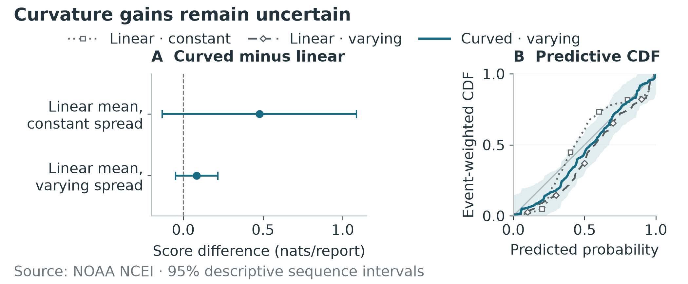

## Abstract

Historical tsunami records do not always describe arrival in the same way. Some give a travel duration, while others give an estimated or observed clock time. We examine three quantities separately: travel durations reported by the National Centers for Environmental Information, durations from earthquake origin to observations reported by the National Tsunami Warning Center, and the differences between that center's estimated and observed times. The fitted datasets contain 1,215 reports from 47 events, 258 from 20 events, and 169 from 18 events, respectively. We compare Bayesian models by predicting reports from groups of events left out of fitting and by plotting simulated reports against the observations. On the same exploration dataset, allowing residual spread to vary with distance changes the estimated between-event standard deviation from 0.352 to 0.046 log units. Adding curvature to the mean gives an estimated prediction-score gain of 0.084 nats per report, with a descriptive 95% interval of [-0.049, 0.217]. This interval leaves the benefit of curvature uncertain. All three final fits pass the reported sampling checks but still miss features of the observed distributions. The figures show how these results depend on the residual model and distinguish uncertainty in the fitted center from the wider range of a new report. The findings apply to the selected historical reports. Physical first-arrival accuracy and operational forecast performance remain unvalidated.

**Keywords:** Bayesian modeling, tsunami arrival times, hierarchical models, uncertainty visualization, posterior predictive checks.

## 1. Introduction

To compare tsunami arrival estimates with observations, we first need to know what each time represents. Historical records often lack that context. An estimate may have no issue time or product version. An observed time may lack a date or refer to a different wave feature from another source's arrival. Records from nearby locations may also come from different instruments or periods of operation. These details determine whether two reported times support a meaningful comparison.

These differences also affect how a model should be displayed. A narrow band around a smooth curve can suggest precise predictions even when individual reports vary widely. An event effect can appear to measure a difference between tsunamis while absorbing variation that the rest of the model fails to describe. The figures must therefore identify what was measured and which source of uncertainty each interval includes.

We use public Pacific tsunami records to address three questions. Which reported times can be compared using consistent rules? How does the relationship with distance affect the variation attributed to individual events? How well do the fitted models reproduce the reports and predict groups of related events left out of fitting? Our initial aim was to model uncertain first-wave arrivals. The available records do not provide a common, independently validated definition of that arrival, so this study models the reported values.

The analysis follows those questions from data preparation to model comparison. We define each timing quantity, compare simpler models with event hierarchies, and use three figures to explain what changes when the model changes. We report where predictions improve, where they remain uncertain, and where the fitted distributions still fail to match the data.

## 2. Background and related work

Warning messages, modeled arrivals, and water-level observations serve different purposes. Observing networks and forecast products inform warning services,[^noaa_warning] while travel-time maps describe modeled propagation.[^ncei_travel_maps] The historical NCEI database compiles reports from many sources. It defines arrival as the first wave at a runup location but notes that an original source may report a later wave.[^ncei_tsunami_data] These quantities require separate definitions before comparison.

Earlier work combines reduced-order physical models with hierarchical pooling for probabilistic tsunami forecasting.[^coffing2026] Our study examines a different part of the problem. It asks what can be learned from the times recorded in historical archives. We model relationships among those reports rather than estimate the initial sea-surface condition that generated a tsunami.

Bayesian workflow combines model building with checks of both the calculations and the model's predictions.[^gelman2020workflow] Plots help reveal patterns that a single score can conceal.[^gabry2017visualization] The checks answer different questions. Convergence diagnostics assess whether the sampling chains produce consistent posterior summaries. Simulation-based calibration examines inference using data generated from a known model.[^talts2018sbc] Posterior predictive checks ask whether the fitted model can reproduce features of the actual observations. Reliable calculations are necessary, but they do not guarantee that the model describes the data well.

## 3. Data and observational targets

### 3.1. Sources and reports included

We collected all 118 entries in the historical National Tsunami Warning Center (NTWC) archive.[^ntwc_messages] An archive entry does not necessarily represent an independent earthquake. After checking the event information, we assigned 57 entries to model development and reserved 18 for later evaluation. We recorded the reasons for excluding or leaving uncertain the other 43. The development tables contain 1,177 rows, of which 388 provide complete estimated and observed time pairs supported by the original sources. We kept incomplete rows in the data so their missing information could be examined. We also retained additional warning messages, but linked them to observations only when the source evidence supported that link. The paper's evidence index lists the tables behind these counts and decisions.

The National Centers for Environmental Information (NCEI) supplies a separate set of positive reported travel durations. We began with 1,221 records across 47 events. Three event/site combinations had repeated records whose relationship could not be resolved. We excluded all six records in those combinations, leaving 1,215 reports from the same 47 events. The exclusions address ambiguity about repeated evidence. They were not based on whether a reported time looked unusual.

Table 1 shows the reports used to fit each model. A complete NTWC pair alone was not sufficient for inclusion. We also needed enough geographic and calendar information to place the report and interpret its time.

| Response | Definition | Eligible reports | Events |
|:--|:--|--:|--:|
| NCEI duration | Positive travel duration reported by NCEI | 1,215 | 47 |
| T-OBS | Reported observed UTC minus reviewed USGS origin | 258 | 20 |
| T-CAL | Reported estimated UTC minus reported observed UTC | 169 | 18 |

**Table 1.** Reports used in the final fits. Each timing quantity has its own inclusion rules. The NCEI count excludes the six ambiguous repeated records. The two NTWC datasets can share the same observed time and are fitted separately.

### 3.2. Meaning of a timing difference

For a record with estimated time $E$ and reported observed time $O$, we define the signed discrepancy

$$\Delta=E-O.$$

A negative value means the estimate is earlier than the reported observation. This comparison concerns the two arrival times. To measure warning lateness, we would also need to know when the warning was issued and which product version and reference origin it used. That information is not sufficiently resolved in these records.

The positive NTWC duration is $Y_O=O-T_{\mathrm{origin}}$, using a reviewed USGS origin that may differ from the historical product's origin. NCEI's reported travel duration remains a separate target. We do not reconstruct missing dates from distance or another station's time. The two NTWC targets share the observed time $O$, so they would not be independent in a combined likelihood. We fit each target separately.

We fit the times as reported, using continuous probability distributions. We keep their displayed precision in the source records, but do not treat it as a measure of accuracy. For example, a time displayed to the minute does not tell us how closely the observer identified the first wave. The fitted models therefore describe variation in reported times. They do not separately estimate rounding error or uncertainty in the physical arrival itself.

### 3.3. Missing times and their implications

Of the 789 NTWC rows without a complete pair, 513 lack at least one time in the source table and 230 lack enough calendar information to resolve a date. The remaining 46 include 35 structural or blank rows, seven times marked with qualifications, three footnoted times, and one row whose column meaning could not be verified. Across the source tables, 297 estimated times and 289 observed times are absent. These counts overlap because 73 rows lack both. They describe rows found in the archive, not every station that could have reported an arrival.

Source documents describe gaps near arrival for four of the 289 absent observations, although they do not establish what caused those gaps. General reporting policies also provide context, but do not explain each missing time. We cannot determine whether missingness is completely random, depends on recorded information, or depends on values that were not recorded. The fitted models consequently describe the reports that met our inclusion rules. Extending their conclusions to all arrivals would require assumptions about the missing reports that we cannot verify.

## 4. Models and computational checks

### 4.1. Reference scale and model comparisons

Let $d_i$ be geodesic source-to-site distance in kilometers. We use the fixed reference duration

$$t_0(d)=\frac{1000d}{60\sqrt{gh}},\qquad g=9.80665\ \mathrm{m\,s^{-2}},\quad h=4000\ \mathrm{m},$$

in minutes, and $x_i=\log(d_i/1000)$. This reference assumes a direct path through water of constant depth. It gives durations at different distances a common basis for comparison. It does not account for actual bathymetry, and $h$ refers to water depth rather than earthquake focal depth. For positive durations, we model $r_i=\log(Y_i/t_0(d_i))$. A value of zero means the reported duration equals the reference. A positive value means it is longer.

The pooled model gives every report the same mean on the response scale being modeled. For durations, this is the log ratio to the reference time, which already changes with distance. The next model adds a linear term in log distance to describe departures from that reference relationship. We then consider differences between events, residual spread that changes with distance, and a curved mean where the exploratory checks suggest these may help. In an event hierarchy, reports from the same event share an offset. Partial pooling estimates the offsets together, allowing events with less information to borrow from the overall distribution.[^gelmanhill2007] Residual spread describes the variation that remains after accounting for the fitted mean and event offset. The same pattern in the data can sometimes be explained by either source of variation. We do not include station effects in the final models because sparse coverage and repeated location names do not establish whether reports came from the same instrument deployment.

### 4.2. Hierarchical NCEI duration model

The selected NCEI model is

$$r_i\sim\mathcal N\!\left(\alpha+\beta x_i+\gamma b(d_i)+u_{e[i]},\ \sigma(d_i)^2\right),$$

$$b(d)=\log\!\left(\frac{d+500}{1.5d}\right),\qquad u_e\sim\mathcal N(0,\tau^2).$$

Here $\mathcal N(\mu,v)$ has mean $\mu$ and variance $v$. The offset $u_e$ shifts the mean for event $e$, and the standard deviation (SD) $\tau$ describes how much those offsets vary across events. The function $b(d)$ allows the mean to curve with distance. It equals zero at 1,000 km, so $\alpha$ gives the log ratio of the median duration to the reference duration there when the event offset is zero. The coefficient $\gamma$ controls this statistical curve. It does not identify a physical delay caused by a continental shelf or another propagation mechanism.

Residual standard deviations $s_j$ are specified at anchors $a_j\in\{500,2000,5000\}$ km. Between adjacent anchors,

$$\sigma(d)=(1-w)s_j+ws_{j+1},\qquad w=\frac{\log d-\log a_j}{\log a_{j+1}-\log a_j}.$$

Below 500 km and above 5,000 km, we hold the SD at the nearest anchor's value. Between anchors, we interpolate the SD itself rather than its logarithm. The spread is free to increase or decrease with distance. Independent priors are $\alpha\sim\mathcal N(0,0.5^2)$, $\beta\sim\mathcal N(0,0.25^2)$, $\gamma\sim\mathcal N(0,0.5^2)$, and $\tau,s_j\sim\operatorname{HalfNormal}(0.4)$. We chose these prior scales with the exploratory data analysis (EDA) in mind. They express modeling assumptions rather than physical constants or upper bounds.

### 4.3. Separate NTWC models

For T-OBS, the selected model is $r_i\sim\mathcal N(\alpha_O,\sigma_O^2)$, with $\alpha_O\sim\mathcal N(0,0.5^2)$ and $\sigma_O\sim\operatorname{HalfNormal}(0.4)$. Pooling applies to the log-relative duration. The median in minutes still increases with distance through $t_0(d)$.

For T-CAL, the model operates directly in signed minutes:

$$\Delta_i\sim\mathcal N(\alpha_C+\beta_C x_i,\sigma_C^2).$$

Its priors are $\alpha_C\sim\mathcal N(0,30^2)$ minutes, $\beta_C\sim\mathcal N(0,15^2)$ minutes per unit log distance, and $\sigma_C\sim\operatorname{HalfNormal}(30)$ minutes. Neither selected NTWC model includes event or station terms. The comparisons below explain why we retain these simpler forms.

### 4.4. Checking the calculations and predictions

Each final fit uses four sampling chains, 1,000 tuning steps and 2,000 retained draws per chain, with target acceptance 0.95. We checked the model's probability calculations and gradients, reproduced its saved summaries, and used simulated data to examine parameter recovery and calibration for the relevant development models. Six further simulations with fixed, known parameter values checked the selected model computations. Those six runs were computational checks, not a study of calibration or interval coverage.

We assess rank-normalized $\widehat R$ and effective sample size,[^vehtari2019rhat] together with divergences and whether the sampler reaches its maximum tree depth. We then simulate reports from the fitted model and compare their quantiles with those in the observed data. These posterior predictive checks use five distance groups, three quantiles, and two displayed scales, giving 30 comparisons for each timing quantity. We flag a comparison when the observed quantile falls outside the central 90% interval of simulated quantiles. The comparisons are dependent because the distance groups overlap and the quantiles are correlated. For T-CAL, the two scales also repeat the same signed values. The number of flags therefore summarizes where the model and data disagree. It is not an estimate of predictive coverage.

## 5. Predictive comparisons and visual design

### 5.1. Sequence-aware predictive comparisons

We divided the 57 development entries into 38 for exploration and 19 for a later check. Both sets had already been examined during EDA, so the later check cannot serve as an independent test. We used event information to group related entries into source sequences. When predicting a sequence, we removed all its members from training to reduce leakage between related events. The main NCEI comparison uses 1,064 exploration reports from 33 events in 29 sequences. T-OBS uses 236 reports in 13 sequences, and T-CAL uses 156 reports in 12 sequences.

We score how much predictive probability density a model assigns to the omitted reports. Higher log scores indicate better predictions within a target. Dividing each event's joint score by its report count and then averaging gives each event equal weight:

$$S=\frac{1}{J}\sum_{e=1}^{J}\frac{\log p(\mathbf y_e\mid\mathcal D_{-q(e)})}{n_e},$$

Here $q(e)$ is the source sequence containing event $e$, and $n_e$ is its report count. Reports from an event share an event offset, so we integrate over that offset jointly when calculating their predictive density. For duration models, we also transform the density from the log scale back to minutes. We compare scores only for models fitted to the same timing quantity and reports. Numerical Monte Carlo error describes how precisely we calculated the score. Uncertainty across sequences describes how much the comparison varies across the event groups, and also depends on the grouping and overlap between training sets.

We fixed the model forms and priors before using the 19-entry check. One source sequence had members on both sides of the original split. We therefore removed its exploration member from every model's training data for that check. Afterward, we fitted the selected models to all eligible development reports. The 18 reserved outcomes have not been examined and contribute no results to this paper.

### 5.2. How the figures support model decisions

The three figures address different modeling decisions. Figure 1 places residual spread beside estimated event variation, showing how a change in the observation model affects the variation attributed to events. Figure 2 compares prediction scores and predicted probabilities for models with linear and curved means. Figure 3 shows uncertainty in the fitted median alongside the wider range predicted for a new report. Together, the figures connect the model assumptions to their consequences for interpretation and prediction.

In Figure 3, dark intervals show uncertainty in the population median. Lighter intervals include the variation of a new report, with a new-event offset added for NCEI. The center can be estimated precisely even when the new-report interval is wide. Durations use logarithmic axes, while signed timing differences use a linear axis so early and late estimates remain easy to distinguish. Hatching marks distances beyond those represented in the fitted data. A separate mark shows where the NCEI residual SD is held at its nearest anchor value. Each of the nine points is a saved prediction. The connecting lines guide the eye without adding predictions between those points. The central 90% intervals apply separately at each distance, rather than simultaneously to the entire curve.

The figures use established static displays to explain the analysis. We have not evaluated them in a user study or measured whether they improve decisions. The separate visual-story prototype is outside the evaluation reported here.

## 6. Results

### 6.1. Event variation depends on the residual model

Figure 1 compares two models fitted to the same 1,064 NCEI exploration reports from 33 events. With constant residual spread, the estimated event SD is 0.352 [0.220, 0.510]. Allowing that spread to vary with distance gives an event SD of 0.046 [0.029, 0.084]. These values are posterior medians with central 90% intervals. The change comes from the residual model rather than a change in prior settings. A pattern attributed to differences between events in the first model can be represented by distance-dependent spread in the second. This is why the event SD cannot be interpreted directly as physical variation between tsunamis.

**Figure 1.** Changing residual spread changes the estimated event variation. Both models use the same 1,064 NCEI reports from 33 exploration events. Bands and bars show central 90% posterior intervals. The event SD depends on the fitted residual model and does not isolate physical variation between tsunamis. Source: NOAA NCEI.

### 6.2. The predictive gain from curvature remains uncertain

For NCEI, adding a distance term improves prediction relative to the pooled log-relative model. The score difference is 0.423 nats per report [0.111, 0.736], using a descriptive 95% interval that groups uncertainty by sequence. Among hierarchical models, the score is -6.2426 for a linear mean with constant spread, -5.8490 for a linear mean with varying spread, and -5.7651 for a curved mean with varying spread. The curved model's estimated gain over the linear varying-spread model is 0.0839 nats per report, with an interval of [-0.0487, 0.2165] (Figure 2). Because that interval spans zero, it does not establish that curvature predicts better. Monte Carlo standard errors near 0.0001 indicate that the hierarchical scores were calculated precisely. They do not remove the much larger uncertainty across sequences.

For the NTWC data, the comparisons leave the benefit of event effects uncertain. In T-OBS, the event model's score minus the pooled model's score is -0.424 [-1.382, 0.534] nats per report. In T-CAL, the event model's score minus the distance model's score is 0.0205 [-0.0988, 0.1397]. Both intervals are descriptive 95% sequence-cluster intervals. We retain the simpler NTWC models, while recognizing that these comparisons do not establish that the alternatives are equivalent.

**Figure 2.** Predicting omitted sequences for 1,064 NCEI reports from 33 events in 29 sequences. In panel A, positive differences favor the curved model with varying spread. Bars show descriptive 95% sequence-cluster intervals. For each omitted report, panel B calculates the predicted probability that a new report would have a shorter duration. The curves show the cumulative distribution of those probabilities, weighting events equally. Uniform probabilities would follow the diagonal. Shading shows the curved model's descriptive 95% sequence-bootstrap band, calculated from the largest bootstrap deviation across the evaluated probabilities. The band is not a uniformity test. Source: NOAA NCEI.

### 6.3. Estimates and predictions using all development reports

The estimates below use all eligible development reports. Parameter values are posterior medians with central 90% intervals. The prediction intervals also include the variation expected in a new report.

**Figure 3.** Uncertainty in the median and in a new report at nine saved distances. All intervals are central 90% and apply separately at each distance. NCEI predictions include a new-event offset. The NTWC models have no event term. Signed differences are estimated minus observed UTC. Hatching marks distance extrapolation. The NCEI residual SD is held constant below 500 km and above 5,000 km. These predictions describe archive reports and have not been validated as physical arrival forecasts. Sources: NOAA NCEI and NTWC.

For NCEI, the curvature coefficient is $\gamma=0.546$ [0.428, 0.661] and the event SD is $\tau=0.0655$ [0.0436, 0.0981]. Residual SD medians at 500, 2,000 and 5,000 km are 0.632, 0.691 and 0.0993, respectively. The fitted spread is smaller at the farthest anchor. These are estimates under the selected model, which helps explain why a nonzero curvature coefficient can coexist with an uncertain prediction-score gain. Estimating a coefficient within one model and comparing how different models predict omitted events answer different questions.

For T-OBS, $\alpha_O=0.102$ [0.0562, 0.148] and $\sigma_O=0.442$ [0.411, 0.476]. At 1,000 km, the median duration is 93.2 [89.0, 97.5] minutes. A new report has a much wider 90% predictive interval: [44.2, 200.9] minutes. Figure 3 makes this distinction visible. Estimating the center precisely does not make an individual report equally predictable.

For T-CAL, $\alpha_C=-6.73$ [-11.59, -1.91] minutes and $\beta_C=-9.67$ [-12.44, -6.98] minutes per unit log distance, with residual SD 25.2 [23.1, 27.6] minutes. The fitted center becomes more negative as distance increases in these reports. At 1,000 km, however, the new-report interval spans -48.3 to +32.7 minutes. Individual estimates can therefore fall on either side of the reported observations. The distance slope summarizes this set of reports without identifying what caused the timing differences.

### 6.4. Good sampling does not ensure a good predictive fit

All three final fits have zero divergences and zero maximum-depth hits. Their largest $\widehat R$ is 1.00145. The smallest bulk and tail effective sample sizes are approximately 2,984 and 3,804. These checks support the reported posterior calculations, although they cannot prove that the sampler explored every relevant region or that the model describes the data adequately.

The predictive checks show clear remaining disagreements with the data. Observed quantiles fall outside the central 90% intervals of simulated quantiles in 20 of 30 NCEI comparisons, 21 of 30 T-OBS comparisons, and 10 of 30 T-CAL comparisons. As explained in Section 4.4, these comparisons are dependent and their counts do not measure prediction coverage. They show that fitting all eligible development reports still leaves important features of the observed distributions unexplained.

### 6.5. Sensitivity and incomplete comparisons

The sensitivity analysis produced 54 usable fits from 55 planned checks. One check remains unresolved. When restricted to reports from 2014 onward, the linear NCEI model failed the divergence criterion even after a reviewed numerical retry. The curved model produced a usable fit for that period, but this alone cannot show that it is more robust. The corresponding linear-model comparison is still missing.

Two overall prediction scores could not be calculated accurately enough in the later development check. These were the NCEI model with a linear mean and varying spread, and the pooled T-CAL model. We retained their predictions for individual reports. A separately reviewed integration calculation resolved an initial score failure for the selected NCEI model without changing its model, priors, training reports, or individual-report predictions. The two remaining score gaps limit the comparison. The small NTWC check datasets and earlier EDA inspection of the check data also restrict what can be concluded.

## 7. Discussion and limitations

The size of an event effect depends on what the rest of the model already explains. Figure 1 makes that dependence visible. Allowing the residual spread to change with distance leaves much less variation for the event hierarchy. Differences in the earthquake source, propagation path, reference origin, and reporting process could all contribute to the event term. The available records do not allow us to separate those causes.

The negative T-CAL distance slope needs similar care. It describes a relationship in the included reports, but cannot distinguish effects of forecast versions, shared source records, or differing arrival definitions. Repeated location names also do not establish that the same instrument operated throughout the record. Predicting at a familiar distance therefore does not by itself demonstrate that the model will transfer to a new station, region, deployment, or earthquake sequence.

The data and model limitations affect how broadly the results can be used. Reports with complete, interpretable time pairs may differ from those with missing information, and the missingness mechanism remains unknown. The models do not separately estimate uncertainty in first-wave identification or rounding, station effects, dependence across source collections, or differences between forecast versions. The predictive checks show remaining mismatch, and two prediction-score comparisons and one time-period sensitivity check remain unresolved. Finally, the development check had already been inspected during EDA, while the reserved outcomes remain unopened. An independent predictive evaluation is still needed.

Further work should first establish which instruments produced the observations, how arrivals were identified, and which forecast versions supplied the estimates. That information would support more explicit models of measurement uncertainty and more interpretable forecast comparisons. The remaining predictive disagreements also need investigation under a new development plan. Before examining the reserved outcomes, event metadata should be checked for sequences shared with the development data. The prediction tests and comparison criteria should then be fixed in advance, without tuning on the reserved timing outcomes.

## 8. Code and data access

The GitHub repository linked on the first page contains the scripts for downloading and processing the public data, the model-fitting code, and the code used to produce the figures. The repository's data guide lists the sources and explains how to repeat the collection and preparation steps. Its setup instructions specify the software environment and any access requirements.

Saved result tables show which reports each model used and record the model settings, random seeds, posterior summaries, and predictive checks. The paper's evidence index links the reported numbers and figures to those tables. Large downloaded files and posterior draws are kept locally and are not included in the GitHub repository. File checksums are recorded so that copies can be checked against the files used in the study. The paper uses the saved results directly, without fitting additional models or calculating new predictions for the figures.

\raggedbottom
\begingroup
\interlinepenalty=10000

## 9. Conclusion

The analysis shows why the observation model matters when interpreting a tsunami event hierarchy. Allowing residual spread to vary with distance changes how much variation is attributed to events. The extra predictive benefit of curvature remains uncertain, and satisfactory sampling checks coexist with clear predictive mismatch. These findings describe the selected historical reports. Establishing physical first-arrival accuracy or operational forecast performance will require stronger information about how those times were produced and an independent predictive evaluation.

\par
\endgroup

[^noaa_warning]: NOAA, *Detection, Warning, and Forecasting* (accessed November 9, 2026). [@noaa_warning]

[^ncei_travel_maps]: NOAA NCEI, *Tsunami Travel Time Maps* (accessed November 9, 2026). [@ncei_travel_maps]

[^ncei_tsunami_data]: NOAA NCEI, *Introduction to Global Historical Tsunami Data* (accessed November 9, 2026). [@ncei_tsunami_data]

[^coffing2026]: S. X. Coffing and colleagues, *Reduced Order Modeling for Tsunami Forecasting With Bayesian Hierarchical Pooling*, JAMES (2026). [@coffing2026]

[^gelman2020workflow]: A. Gelman and colleagues, *Bayesian Workflow*, arXiv:2011.01808 (2020). [@gelman2020workflow]

[^gabry2017visualization]: J. Gabry and colleagues, *Visualization in Bayesian Workflow*, JRSS A (2019). [@gabry2017visualization]

[^talts2018sbc]: S. Talts and colleagues, *Validating Bayesian Inference Algorithms with Simulation-Based Calibration*, arXiv:1804.06788 (2018). [@talts2018sbc]

[^ntwc_messages]: National Tsunami Warning Center, *Previous Tsunami Messages* (accessed November 9, 2026). [@ntwc_messages]

[^gelmanhill2007]: A. Gelman and J. Hill, *Data Analysis Using Regression and Multilevel/Hierarchical Models*, Cambridge University Press (2007). [@gelmanhill2007]

[^vehtari2019rhat]: A. Vehtari and colleagues, *Rank-Normalization, Folding, and Localization: An Improved $\widehat{R}$ for Assessing Convergence of MCMC*, Bayesian Analysis (2021). [@vehtari2019rhat]

## Acknowledgments

We acknowledge NOAA's National Tsunami Warning Center and National Centers for Environmental Information, the USGS, and the original observing and reporting organizations. OpenAI ChatGPT/Codex assisted with analysis-code development, numerical verification, figure-generation code, and drafting and editing this manuscript. The author retains responsibility for the final scientific content and submission.

## References
