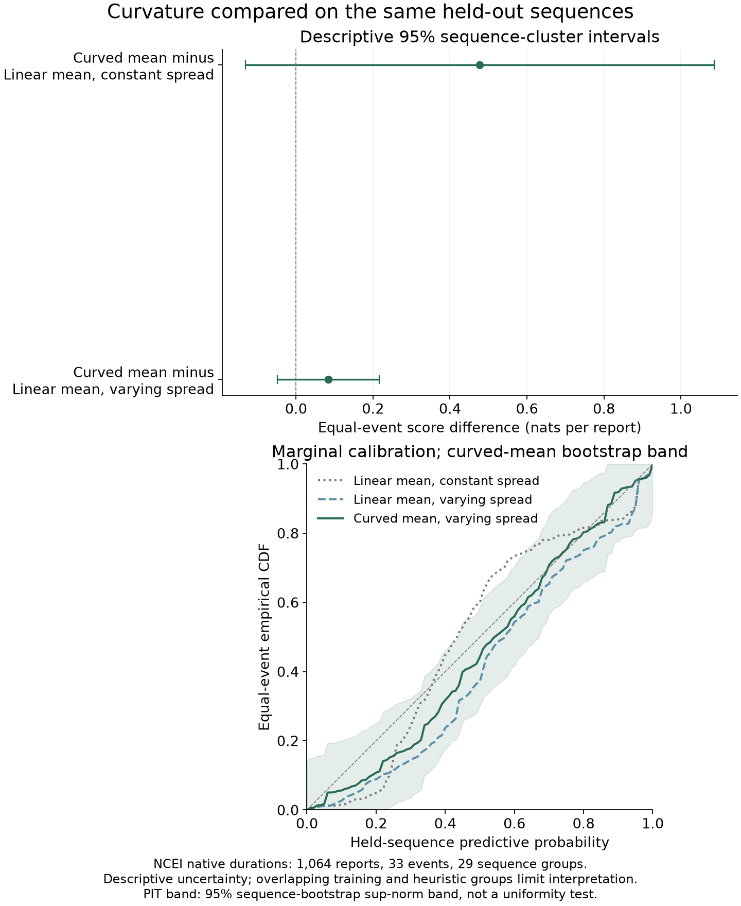

## Abstract

Historical tsunami archives contain estimated arrivals, reported observations, and travel durations whose definitions and availability differ. These differences constrain both Bayesian models and the interpretation of their uncertainty. We study public Pacific tsunami records using three separate reported-timing targets: National Centers for Environmental Information travel durations, National Tsunami Warning Center observed-minus-origin durations, and estimated-minus-observed timing differences. The full development fits contain 1,215 reports from 47 events, 258 from 20 events, and 169 from 18 events, respectively. We compare distance-based and hierarchical models through sequence-grouped prediction, sensitivity analysis, and visual predictive criticism. On the same exploration cohort, changing the residual-spread model changes the posterior median between-event standard deviation from 0.352 to 0.046 log units. Adding mean curvature yields an estimated sequence-prediction gain of 0.084 nats per report, with a descriptive 95% interval of [-0.049, 0.217]. All three final fits pass the reported sampling checks, yet substantial conditional predictive discrepancies remain. These findings show how residual specification and source semantics limit interpretations of event variation and apparent timing bias. The resulting uncertainty displays distinguish parameter uncertainty, report variation, and distance extrapolation. The study supports archive-conditional model criticism; it does not establish physical first-arrival accuracy or operational forecasting performance.

**Keywords:** Bayesian modeling; tsunami arrival times; hierarchical models; uncertainty visualization; posterior predictive checks.

## 1. Introduction

An arrival-time comparison appears straightforward: subtract an observed arrival from a predicted arrival and model the difference. Historical tsunami records complicate each part of that calculation. A published estimate can lack its issuing time or product version. An observed clock can lack a resolved date or denote a different wave feature from another source's arrival. Geographic proximity between records does not establish that the same deployment or measurement generated them. A numerical difference is therefore useful only after its observational meaning is established.

These distinctions matter for uncertainty visualization. A smooth fitted curve and a narrow posterior band can suggest a precise account of tsunami propagation even when they summarize heterogeneous reported values. A hierarchical event effect can appear to isolate a tsunami-specific departure while also absorbing an inadequate model of residual variation. An uncertainty display must make clear which target, population, and variation its intervals describe.

We investigate these issues in a source-separated Bayesian study of Pacific tsunami arrival records. Our questions are: **(1)** which reported timing quantities support reproducible comparisons; **(2)** how distance-dependent mean and spread specifications affect inferred event variation; and **(3)** whether computationally well-behaved models reproduce the observed distributions and predict omitted source sequences. The completed analysis narrows the initial goal of estimating uncertain physical first-wave picks: we model native reported values because a common independently validated onset definition is unavailable.

Our contributions are an auditable separation of three timing targets; an empirical demonstration of model-dependent event-variance attribution; and a visual comparison of fitted relationships, predictive uncertainty, and model discrepancies. We evaluate models against simpler alternatives and retain unresolved numerical comparisons. The contribution is a reproducible modeling case study, rather than a new tsunami propagation solver or an evaluated interactive visualization system.

## 2. Background and related work

Warning messages, modeled arrival fields, and water-level observations serve different purposes. NOAA describes how observing networks and forecast products inform tsunami warning services [@noaa_warning]. NCEI distributes travel-time maps as modeled products [@ncei_travel_maps], while its historical database compiles observations from heterogeneous sources. NCEI defines arrival as the first wave at a runup location, while noting that an original source may instead report a later wave [@ncei_tsunami_data]. These products cannot be treated as interchangeable measurements of a single precisely observed onset.

Bayesian hierarchical tsunami modeling already has direct precedents. Coffing et al. combine reduced-order physics-based modeling with hierarchical pooling for probabilistic tsunami forecasting [@coffing2026]. Our study addresses a different evidence problem: how reported arrival quantities in historical archives support retrospective statistical comparisons. We do not claim the first hierarchical Bayesian treatment of tsunami timing, infer an initial sea-surface condition, or validate a reduced-order physical forecast.

Bayesian workflow combines model construction, computational diagnostics, predictive checking, and revision [@gelman2020workflow]. Visualization supports each stage by exposing structure that scalar summaries can conceal [@gabry2017visualization]. We use this established approach to examine reported timing, with separate displays for parameter uncertainty and report-level prediction. Rank-normalized convergence diagnostics address sampling behavior [@vehtari2019rhat]; simulation-based calibration checks computation under a specified simulator [@talts2018sbc]. Neither establishes that a reported clock is a physical first arrival or that a fitted distribution is adequate for historical reports.

## 3. Data and observational targets

### 3.1. Archive scope and eligibility

The acquired snapshot preserves all 118 entries in the historical NTWC event archive. Archive entries are not necessarily independent earthquakes. A metadata screen retains 57 development entries and reserves 18 for later evaluation; the remaining 43 retain their exclusion or uncertainty reasons. The development collection contains 1,177 NTWC table rows, of which 388 have source-supported complete reported-time pairs. Rows lacking complete pairs remain in the source tables. We retained additional original warning messages from the NTWC archive [@ntwc_messages] as separately identified products and did not automatically join them to similarly named observation locations. These study-specific counts and decisions are traceable through the accompanying evidence index, which identifies the frozen cohort, source-process tables and input checksums.

The NCEI collection supplies a separate set of explicit positive reported travel durations. The analysis begins with 1,221 duration candidates across 47 development events. Six records belong to three unresolved repeated event/site groups; the evidence rule excludes every record in each such group, leaving 1,215 records while retaining all 47 events. This rule concerns unresolved evidence multiplicity, rather than unusual response values.

Table 1 distinguishes source-candidate counts from fitted cohorts. The 57-entry development catalog is not the event count of each response. Geographic review and calendar support restrict the NTWC model cohorts further than the presence of a complete pair alone.

| Response | Definition | Eligible reports | Events |
|:--|:--|--:|--:|
| NCEI duration | Explicit native positive reported travel duration | 1,215 | 47 |
| T-OBS | Reported observed UTC minus reviewed USGS origin | 258 | 20 |
| T-CAL | Reported estimated UTC minus reported observed UTC | 169 | 18 |

**Table 1.** Full-development modeling cohorts. Counts are target-specific and are not independent samples across source families. The NCEI cohort follows the repeated-evidence exclusion; the two NTWC targets can share the same observed clock.

### 3.2. Meaning of a timing difference

For a record with estimated time $E$ and reported observed time $O$, we define the signed discrepancy

$$\Delta=E-O.$$

A negative value means that the reported estimate precedes the reported observation. It does not measure how late a public warning was issued. Product issue time, version, and the origin used to generate the historical estimate are not sufficiently resolved to interpret this target as operational forecast error.

The positive NTWC duration is $Y_O=O-T_{\mathrm{origin}}$, using a reviewed USGS reference origin. This need not be the origin used by the historical warning product. NCEI's native travel duration remains a separate response; missing absolute arrival dates are not reconstructed from distance or another station's clock. Because $Y_O$ and $\Delta$ share $O$, the two responses are not independent observations for a combined likelihood. We fit all source targets separately.

We retain native reported values and display precision, using working continuous point-value likelihoods. We do not convert minute display into an assumed accuracy bound, fit a rounding or interval-censoring model, or estimate a latent physical-onset process. Those extensions require evidence about the measurement and reporting process that this corpus does not supply.

### 3.3. Availability and selection

Of the 789 NTWC rows without a complete pair, 513 have at least one timing field absent in the source table, 230 have unresolved calendar context, 35 are structural or blank, seven have qualified clocks, three have footnoted clocks, and one has unverified column meaning. Within the source-absence group, 297 estimates and 289 observations are absent, with 73 rows missing both. These are counts of retained table rows, not all possible event-station reporting opportunities.

Documentary investigation supports near-arrival gaps for four of the 289 absent observed fields; it does not establish their technical cause. General conditional-reporting policies cannot explain every individual blank. The available evidence therefore does not identify missing completely at random, missing at random, or missing not at random mechanisms. We condition the models on archive inclusion and target eligibility, rather than infer a population-wide arrival process or fill absent forecasts with model predictions.

## 4. Bayesian models and computational checks

### 4.1. Reference scale and candidate ladder

Let $d_i$ be geodesic source-to-site distance in kilometers. We use the fixed reference duration

$$t_0(d)=\frac{1000d}{60\sqrt{gh}},\qquad g=9.80665\ \mathrm{m\,s^{-2}},\quad h=4000\ \mathrm{m},$$

in minutes, and $x_i=\log(d_i/1000)$. The reference is a constant-depth, straight-path normalization. It is not a bathymetric tsunami forecast, and earthquake focal depth is not substituted for water depth. For positive durations, the modeled response is $r_i=\log(Y_i/t_0(d_i))$.

The candidate ladder starts with pooled and distance-only models, then event effects, distance-dependent residual spread, and a curved distance mean where motivated by exploratory model criticism. Complexity is target-specific. We do not fit station effects in the final models because geographic repeats and sparse coverage do not establish a stable deployment-level effect.

### 4.2. Hierarchical NCEI duration model

The frozen selected NCEI form is

$$r_i\sim\mathcal N\!\left(\alpha+\beta x_i+\gamma b(d_i)+u_{e[i]},\ \sigma(d_i)^2\right),$$

$$b(d)=\log\!\left(\frac{d+500}{1.5d}\right),\qquad u_e\sim\mathcal N(0,\tau^2).$$

Here $\mathcal N(\mu,v)$ denotes a Normal distribution with variance $v$. The curvature basis is zero at 1,000 km. Thus $\alpha$ is the log conditional-median/reference ratio at that distance for zero event offset. The local conditional-median elasticity is $1+\beta-500\gamma/(d+500)$. These parameters describe reported timing; $\gamma$ is not an identified shelf delay or propagation correction.

Residual standard deviations $s_j$ are specified at anchors $a_j\in\{500,2000,5000\}$ km. Between adjacent anchors,

$$\sigma(d)=(1-w)s_j+ws_{j+1},\qquad w=\frac{\log d-\log a_j}{\log a_{j+1}-\log a_j}.$$

The endpoint SD is held constant outside the anchor range. We interpolate SD, not log SD, and impose no monotonicity constraint. The independent base priors are $\alpha\sim\mathcal N(0,0.5^2)$, $\beta\sim\mathcal N(0,0.25^2)$, $\gamma\sim\mathcal N(0,0.5^2)$, and $\tau,s_j\sim\operatorname{HalfNormal}(0.4)$. These are analyst-specified, EDA-informed scales on the log-response scale, rather than elicited physical constants or upper bounds.

### 4.3. Separate NTWC models

For T-OBS, the frozen pooled form is $r_i\sim\mathcal N(\alpha_O,\sigma_O^2)$, with $\alpha_O\sim\mathcal N(0,0.5^2)$ and $\sigma_O\sim\operatorname{HalfNormal}(0.4)$. Pooled log-relative duration still has a distance-dependent native-minute median through $t_0(d)$.

For T-CAL, the model operates directly in signed minutes:

$$\Delta_i\sim\mathcal N(\alpha_C+\beta_C x_i,\sigma_C^2).$$

Its priors are $\alpha_C\sim\mathcal N(0,30^2)$ minutes, $\beta_C\sim\mathcal N(0,15^2)$ minutes per unit log distance, and $\sigma_C\sim\operatorname{HalfNormal}(30)$ minutes. The selected NTWC forms have no event or station terms. A hierarchical analysis does not require a hierarchy in every source-specific final model.

### 4.4. Computation and predictive criticism

The full fits use four chains, 1,000 tuning steps and 2,000 retained draws per chain, with target acceptance 0.95. The pinned environment includes PyMC 6.4, PyTensor 3.3.8, ArviZ 1.3 and nutpie 0.16.11. Implementation checks include simulation-based recovery/calibration for the relevant developmental models, independent density and gradient checks, and saved-summary replay. Six fixed-truth checks exercise the selected full-design computations before the three full fits; those six are computational smokes, not calibration or coverage studies.

We assess rank-normalized $\widehat R$, effective sample size, divergences and maximum-depth behavior, then inspect conditional posterior predictive distributions. The predictive checks compare observed sample quantiles with the central 90% distribution of replicated sample quantiles. Each target has five distance strata, three quantiles and two displayed scales, giving 30 diagnostic cells. Strata overlap, quantiles are correlated, and the two T-CAL scales duplicate the same signed evidence. Counts of discrepant cells are descriptive summaries, not binomial coverage estimates or calibrated model-selection thresholds.

## 5. Validation and uncertainty displays

### 5.1. Sequence-aware predictive comparisons

The exploratory development split contains 38 archive entries, with 19 entries assigned to a later development check. Both sets had previously been inspected in EDA. Related archive entries are grouped into metadata-defined source sequences; omitted-sequence prediction removes every member of the held sequence from training. The primary NCEI comparison uses 1,064 eligible exploration reports from 33 events in 29 sequences. T-OBS and T-CAL comparisons use 236 reports in 13 sequences and 156 reports in 12 sequences, respectively.

The score averages each event's joint native-minute log predictive density divided by its number of reports:

$$S=\frac{1}{J}\sum_{e=1}^{J}\frac{\log p(\mathbf y_e\mid\mathcal D_{-q(e)})}{n_e},$$

where $q(e)$ is the source sequence containing event $e$. New-event effects are integrated jointly; multiplying separately marginalized row predictions would discard their shared event dependence. Duration scores include the native-minute transformation Jacobian once. Scores are compared only within the same target and cohort. We distinguish Monte Carlo numerical uncertainty from descriptive sequence-cluster uncertainty, whose intervals also remain limited by metadata grouping and overlapping training sets.

Model forms and priors were frozen before the 19-entry development check; that check is not an independent test. One source sequence crosses the original entry split, so check training uniformly purges its exploration member. The original full-development cohort is restored for the frozen refit. Eighteen reserved outcomes remain sealed and contribute no evaluation results to this paper.

### 5.2. Visual distinctions

Our displays answer three different questions. First, residual-spread and event-attribution plots show how a changed likelihood redistributes apparent group variation. Second, paired score and predictive-stratum plots compare omitted-sequence behavior while exposing uncertainty. Third, source-specific distance curves separate uncertainty in a population median from the wider predictive distribution of a new report.

The final distance display uses a dark central 90% pointwise band for the population median and a lighter band for new-report prediction. NCEI predictions include a new event offset and report variation; the NTWC final forms have no event term. Duration axes are logarithmic and timing discrepancies retain a signed linear axis. Hatched distance regions mark extrapolation beyond the fitted range. NCEI residual-scale clamping outside 500–5,000 km is marked separately because it can occur within the observed distance range. Points preserve nine saved prediction distances; connectors do not represent additional evaluated predictions. The bands are pointwise, not simultaneous.

These are static analytical views using established encodings. We do not report a user study, demonstrate improved decision accuracy, or present the separate visual-story prototype as an evaluated paper system.

## 6. Results

### 6.1. Event variation depends on residual specification

On the same 1,064-report, 33-event NCEI exploration cohort, the posterior median event SD changes from 0.352 [0.220, 0.510] under constant residual spread to 0.046 [0.029, 0.084] under distance-varying spread. These are central 90% posterior intervals. The change occurs between model specifications, not merely between prior settings. It shows that an event effect can absorb residual structure under one likelihood and become much smaller under another. Neither estimate identifies a physical between-tsunami variance component.

**Figure 1.** Residual specification and event attribution. The comparison holds the exploration cohort fixed and does not establish that one variance decomposition is physical truth.

### 6.2. Curvature improves a point estimate of sequence score, with uncertainty

The simpler NCEI distance-only model improves the sequence score over the pooled log-relative model by 0.423 nats per report [0.111, 0.736], using a descriptive 95% sequence-cluster interval. Among the hierarchical forms, equal-event sequence-predictive scores are -6.2426 nats per report for a linear mean with constant spread, -5.8490 for a linear mean with varying spread, and -5.7651 for a curved mean with varying spread. Curvature improves the point estimate over the linear varying-spread model by 0.0839 nats per report, but its corresponding interval is [-0.0487, 0.2165]. The evidence does not establish superiority of curvature. Numerical MCSEs near 0.0001 for the hierarchical scores do not remove the much larger uncertainty across sequences.

The earlier NTWC sequence comparisons also do not establish a general advantage for event hierarchies. The event-minus-pooled T-OBS score difference is -0.424 [-1.382, 0.534] nats per report; the event-minus-distance T-CAL difference is 0.0205 [-0.0988, 0.1397]. Both are descriptive 95% sequence-cluster intervals. These results motivate retaining simpler frozen NTWC forms without implying equivalence between the models.

**Figure 2.** Sequence-prediction comparison. Numerical precision and between-sequence uncertainty answer different questions. The comparison is exploratory model-development evidence.

### 6.3. Frozen full-development parameters

Every parameter interval in this subsection is a central 90% posterior interval; prediction intervals additionally include modeled report variation.

The NCEI full fit has curvature coefficient $\gamma=0.546$ [0.428, 0.661] and event SD $\tau=0.0655$ [0.0436, 0.0981]. Its residual SD medians at 500, 2,000 and 5,000 km are 0.632, 0.691 and 0.0993. The fitted spread is consequently much tighter at the far anchor, conditional on this model and archive. The curvature coefficient summarizes the selected mean basis; it does not resolve the uncertain predictive comparison.

For T-OBS, $\alpha_O=0.102$ [0.0562, 0.148] and $\sigma_O=0.442$ [0.411, 0.476]. At 1,000 km the population-median duration is 93.2 [89.0, 97.5] minutes, while the new-report predictive 90% interval is [44.2, 200.9] minutes. A precisely estimated center does not imply a precise individual report.

For T-CAL, $\alpha_C=-6.73$ [-11.59, -1.91] minutes and $\beta_C=-9.67$ [-12.44, -6.98] minutes per unit log distance, with residual SD 25.2 [23.1, 27.6] minutes. The fitted center becomes more negative with distance, conditional on the included archive reports. At 1,000 km, the new-report predictive interval spans -48.3 to +32.7 minutes. Thus a negative center neither implies that every estimate precedes observation nor establishes an operational bias mechanism.

**Figure 3.** Frozen full-development curves from saved quantiles. NCEI includes a new event offset; the selected NTWC forms have no event effects. Lines join nine evaluated distances. These archive-conditional distributions are not validated physical arrival forecasts.

### 6.4. Sampling success coexists with predictive discrepancies

All three full fits have zero divergences and zero maximum-depth hits. Their largest $\widehat R$ is 1.00145, and the smallest bulk and tail effective sample sizes across reported parameters are approximately 2,984 and 3,804. These diagnostics support computation of the stated posterior summaries, without certifying global exploration or model adequacy.

Observed quantile statistics fall outside their replicated central 90% intervals in 20 of 30 NCEI cells, 21 of 30 T-OBS cells, and 10 of 30 T-CAL cells. The duplicated signed-scale display and other cell dependencies preclude interpreting those fractions as prediction coverage. The discrepancies nonetheless show that the selected models do not reproduce important distributional features. Fitting all eligible development records does not resolve this mismatch.

### 6.5. Sensitivity and incomplete comparisons

The prespecified sensitivity program retains 54 usable fits across 55 probes, with one computationally unresolved case. Its 58 sampler calls include four failed attempts, whose draws do not contribute posterior summaries. The linear NCEI 2014-onward stress fails the unchanged divergence screen after its reviewed numerical retry. The usable curved-era result cannot substitute for that missing comparison or establish robustness in favor of curvature.

In the later development check, joint-score precision failures leave aggregate scores unavailable for the NCEI linear varying-spread alternative and the pooled T-CAL alternative. Their marginal predictions remain retained. A separately reviewed integration resolves the selected NCEI model's original score failure without changing its model, priors, training records or marginal predictions. Missing aggregate scores do not establish rejection, equivalence, or a winner. The small NTWC check cohorts and prior EDA exposure further restrict generalization claims.

## 7. Discussion and limitations

The empirical result is a limit on interpretation as much as a fitted relationship. An event SD measures variation left for the event layer under a specified residual model. Its large change under distance-varying spread shows why a visually plausible hierarchy should be examined alongside the observation distribution. A narrow posterior interval can be conditional on a fragile decomposition. The event term also combines source, path, origin and reporting variation; this archive cannot separate those causes.

Likewise, the negative T-CAL distance slope describes the selected records, not a causal source of early estimates. Historical forecast versions, shared source ancestry and arrival definitions remain incompletely resolved. Geography does not verify instrument continuity. A common distance range does not establish transfer to unseen stations, regions, deployment regimes or earthquake sequences.

The visualization choices make several uncertainty distinctions explicit, but their effectiveness has not been evaluated with users. Our static analysis does not supply evidence for a novel interaction technique or a complete operational interface. Its value is the auditable connection between source semantics, model assumptions, statistical summaries and visible discrepancies. A broader visualization contribution would require additional design and evaluation evidence.

Several limitations directly constrain statistical inference. Complete-pair eligibility is selective and its mechanism is unidentified. Working point densities do not propagate unmeasured onset or rounding uncertainty. Site effects, joint cross-source dependence and product-version effects remain unmodeled. Gaussian reported-value models retain conditional predictive mismatch. Two joint-score comparisons and one era stress remain unresolved. The 19-entry development check had prior EDA exposure, and no reserved-outcome test is reported. These limitations preclude a claim of independent predictive validation.

Further work should establish comparable deployment and arrival definitions before expanding the observation model; resolve versioned historical forecasts before interpreting operational calibration; and investigate the remaining predictive discrepancies under a new development protocol. Reserved evaluation should begin only after a metadata-only sequence-overlap audit and a separately frozen assessment contract. It must not become another opportunity to tune the present models.

## 8. Reproducibility and data availability

The study preserves immutable source records, native cells, source locators, eligibility rules and cryptographic input/output checksums. Portable artifacts contain the cohort membership, prior settings, seeds, posterior summaries, predictive-check tables, sequence scores and failure dispositions. The environment is pinned in a lockfile; project-local experiment tracking mirrors the portable run records. Large native posterior files and source-response caches are retained locally with hashes rather than silently embedded in a manuscript supplement.

The manuscript's numerical results are drawn from accepted saved tables. The final curve figure uses their saved quantiles without new prediction or refitting. Source inventories and reproduction instructions accompany the repository. Public-source access does not by itself make a complete, anonymized replication package available: stable archive packaging and any review-time sharing link require author verification before submission. This paper reports no inaccessible reserved-event outcomes.

## 9. Conclusion

Hierarchical Bayesian models can describe source-reported tsunami timings, but their parameters and uncertainty depend on the observational target and residual specification. In this study, distance-dependent spread substantially changes event-variance attribution, the incremental sequence-prediction evidence for mean curvature remains uncertain, and clean sampling coexists with substantial predictive discrepancies. Separate source targets and explicit uncertainty displays make these limitations visible. The resulting analysis supports cautious retrospective interpretation of archive reports; validated physical-arrival and operational forecasting claims require additional evidence.

## Acknowledgments

We acknowledge NOAA's National Tsunami Warning Center and National Centers for Environmental Information, the USGS, and the original observing and reporting organizations. OpenAI ChatGPT/Codex assisted with analysis-code development, numerical verification, figure-generation code, and drafting and editing this manuscript. The human authors retain responsibility for the final scientific content and submission.

## References
